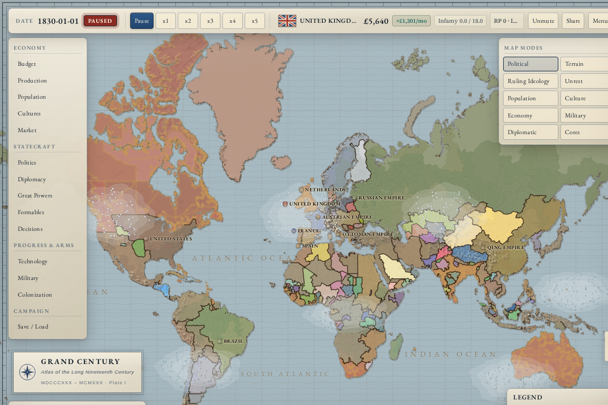

# Grand Century

A browser-based grand strategy game, playable single-player or on a multiplayer server, about the long nineteenth century.
The default campaign starts in 1830, amid the fragile Concert of Europe and Atlantic
revolutions. You take a nation and carry it through a century of industry, reform, and
conquest on a world whose population and markets move whether you are watching or not.
Seven start dates ship as scenarios: 1700, 1776, 1815, 1830, 1914, 1936 and 1945.

Play at [lakesidegames.net/games/grand-century](https://lakesidegames.net/games/grand-century/).

## The game

**A world that lives without you.** Population groups grow, migrate, and promote between
strata. Factories boom and go bust. Prices move on a shared world market. AI nations
pursue their own wars and their own industrialisation. You nudge a system rather than
micromanage a spreadsheet.



**War is the payoff.** Mobilising population into armies, fronts that push and break, war
goals, occupation, peace deals, the great-power pecking order, and the colonial land grab.
Every other system feeds it: the economy funds it, population mans it, politics gates what
you can enact, diplomacy sets it up.

**Legible depth.** Interlocking systems stay understandable through tooltips that trace a
number back to the inputs that produced it.

Real time with pause and five speeds. The world advances one day at a time, with the
heavier systems resolving weekly, monthly or yearly to stay cheap in a browser tab. See
[Time and the tick](docs/systems/time-and-the-tick.md).

### System guides

Each system has a player page that explains how it works and what you can do about it:
[population](docs/systems/population.md),
[production and industry](docs/systems/production-and-industry.md),
[the world market](docs/systems/the-world-market.md),
[budget and taxation](docs/systems/budget-and-taxation.md),
[politics and reform](docs/systems/politics-and-reform.md),
[culture and nationalism](docs/systems/culture-and-nationalism.md),
[crises](docs/systems/crises.md),
[events and decisions](docs/systems/events-and-decisions.md),
[war](docs/systems/war.md),
[diplomacy](docs/systems/diplomacy.md),
[AI nations](docs/systems/ai-nations.md) and
[research](docs/systems/research.md).

## Running it

The web game and native mobile app are maintained together on `master`.
The web app lives at the repository root; `apps/mobile` contains the React
Native app and imports the shared simulation and data from `src`.
See [native setup](docs/NATIVE-MOBILE.md) and the
[remaining parity gates](docs/NATIVE-PARITY.md). The native app is an early
integration preview, not a complete mobile release.

GitHub Actions runs web/mobile checks and an unsigned iOS simulator compile.
Signing and TestFlight distribution are separate from these compile checks.

Use Node 22, the version CI runs. `package.json` does not pin a minimum.

```bash
npm install
npm run dev            # local dev server
npm run build          # production build to dist/
npm test               # unit tests
npm run test:balance   # balance gauntlet
npm run test:all       # everything, including stability runs
```

The simulation is pure TypeScript with no DOM dependencies, so it runs in the browser, in
tests, and headless for batch balance runs. `npm run season-report` and
`npm run probe:pacing` drive the headless paths.

## Design docs

Start with [`docs/ARCHITECTURE.md`](./docs/ARCHITECTURE.md) for the rules the code is
built around, and the [engineering pages](docs/engineering/architecture.md) for the
simulation loop and the worker protocol. [`docs/MASTER.md`](./docs/MASTER.md) is the
original scoping spec and is kept as history. The `ROADMAP-*.md` files are the
per-version scopes and are also historical once shipped. Multiplayer hosting is covered
in [`docs/MULTIPLAYER-DEPLOY.md`](./docs/MULTIPLAYER-DEPLOY.md).

## License

[PolyForm Noncommercial 1.0.0](./LICENSE.md). The source is available to read, learn from,
modify, and run noncommercially. Commercial use, including hosting it as a paid or
ad-supported service, is not licensed.

## Map graphics

Choose **3D · Terrain** for offline raised terrain and animated water, or
**2D · Low power** for the lighter atlas. The setting is remembered. The native
1830 campaign supports both; other web scenarios and analytical layers retain
the 2D atlas. See [graphics and performance](docs/GRAPHICS.md) for the rendering
budgets, data credits and device-validation limits.


