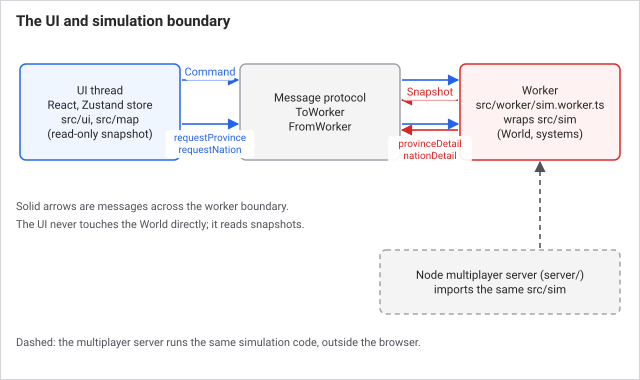

# Architecture

Grand Century is a browser game with the entire simulation running off the main
thread. This document is the contract contributors build against.

## The one hard boundary

**`src/sim/**` and `src/worker/**` are pure logic.** No DOM, no React, no
`window`, no imports from `src/ui` or `src/map`. They may import only from
`src/shared`, `src/sim`, and `src/data`. The one exception is type-only: `src/sim/snapshot.ts`
imports the `SharedSnapshot` and `PlayerView` types from `src/net/snapshotCodec.ts`.

**`src/ui/**` and `src/map/**` only read.** They render the latest
`WorldSnapshot` and dispatch `Command`s. They never mutate world state.

The two sides communicate only through the message protocol in
`src/shared/types.ts` (`ToWorker` / `FromWorker`).

This boundary is what allows the same simulation code to run in a browser worker
and in the Node multiplayer server without modification. Breaking it breaks
multiplayer, not just tidiness.

## Source of truth

- `src/shared/types.ts` is the domain contract: data, protocol and commands.
  Both sides depend on it; change it deliberately.
- The sim owns the mutable `World`.
- The UI owns a Zustand store holding the read-only snapshot plus pure UI state.

## Layout

```
src/shared/types.ts       domain contract (data + protocol + commands)
src/sim/rng.ts            seeded PRNG
src/sim/world.ts          tick loop + cadence dispatch
src/sim/bootstrap.ts      createWorld(data, seed) -> initial World
src/sim/commands.ts       applyCommand(world, data, cmd, post)
src/sim/snapshot.ts       buildSnapshot(world, data) -> WorldSnapshot
src/sim/detail.ts         detailProvince / detailNation (on-demand views)
src/sim/balance.ts        central tuning constants
src/sim/systems/*.ts      one file per simulation system
src/worker/sim.worker.ts  worker entry (message loop + fixed timestep)
src/worker/saveSlots.ts   IndexedDB save slots
src/net/*                 multiplayer transport, codec, session protocol
src/data/gameData.ts      baked static GameData
src/map/*                 MapLibre province map, paint and mapmodes
src/graphics/*            3D terrain, water and city rendering for the map
src/ui/*                  React panels and HUD
content/*                 source data and build scripts for maps and scenarios
server/*                  Node multiplayer server (runs src/sim)
```

## The boundary at a glance

```
 UI thread                       Protocol                  Worker
 src/ui, src/map, store   <--  FromWorker snapshot  <--  src/worker/sim.worker.ts
 (read-only snapshot)     -->  ToWorker command     -->  src/sim (World, systems)
                          -->  requestProvince / requestNation
                          <--  provinceDetail / nationDetail

 Node server (server/) imports the same src/sim.
```



## Systems

Every simulation system is a function with the same shape:

```ts
(world: World, data: GameData, rng: Rng) => void
```

They mutate `World` in place and are dispatched by cadence from `advanceDay`.
Adding a system means adding a file under `src/sim/systems/` and calling it from
the right cadence block in `src/sim/world.ts`. See
[The simulation loop](simulation-loop.md) for why the order within a cadence
matters and for the step-by-step recipe.

## Determinism

All randomness goes through `src/sim/rng.ts`, a seeded mulberry32 generator
threaded through `world.rngState`. **Never call `Math.random()` in sim code.**

This is not a style preference. Saves, replays and multiplayer all depend on the
same inputs producing the same world. A single unseeded random call desynchronises
a multiplayer session and makes a save unreproducible.

Some systems accept an `Rng` parameter they never use (culture, budget and weekly
pops are examples), purely to keep the system signature uniform. That is deliberate.
Why the boundary and the rule matter to you: if sim code could read `window` or
`Math.random()`, the Node server would produce a different world from the browser.

## Performance

- Snapshots are compact summaries, not the whole world. Detailed views (a
  province's pops, a nation's ledger) are pulled on demand via `requestProvince`
  and `requestNation`.
- Keep hot loops allocation-light. The world map has 2,141 provinces built from
  geoBoundaries administrative units (see `CHANGELOG.md`), 169 states hold land
  at the 1830 start, and the pop count grows across a century.
- Prefer hoisting per-pass constants out of per-entity loops. Several measured
  regressions came from recomputing a per-state or per-type value once per pop.

## Verification gate

Before a change is committed:

1. `npm run build`: typechecks and bundles clean.
2. `npm run test`: vitest green.
3. `npm run dev` boots and the milestone's acceptance criterion is met.

## Where things go

- State the sim needs to remember goes on `World` (`src/shared/types.ts`), with an
  `ensureXState` guard for old saves.
- State that only affects what is drawn (selected province, open panel, map mode) goes in
  the Zustand store (`src/store.ts`), never on `World`.
- A new panel lives in `src/ui/panels`, reads the snapshot through the store and sends
  `Command`s. If it needs data the snapshot lacks, add a detail request, see
  [Snapshots and the protocol](snapshots-and-protocol.md).
- To test a system without the worker, build a world and call the system function
  directly, see [The simulation loop](simulation-loop.md).

## Aesthetic

An archival nineteenth-century atlas: aged parchment map, muted province fills,
period display type, ornate but legible panel frames. Dark, readable panel text on
parchment and leather surfaces.

## See also

- [The simulation loop](simulation-loop.md): cadence, ordering, and why
- [Snapshots and the protocol](snapshots-and-protocol.md): how state reaches the UI
- [Time and the tick](../systems/time-and-the-tick.md): the same loop, for players

## Last checked

2026-10-29, version 1.7.0.
