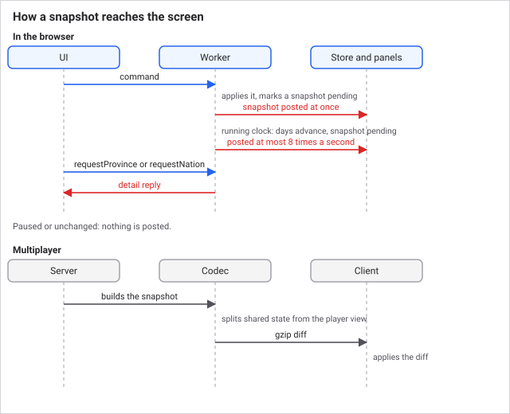

# Snapshots and the protocol

The simulation runs in a worker. The UI never touches `World`, it renders a
`WorldSnapshot` and dispatches `Command`s. This document covers what crosses that
boundary and when.

## The message protocol

`ToWorker` and `FromWorker` in `src/shared/types.ts` are the only channel between
the two sides. Both are plain data.

The worker entry, `src/worker/sim.worker.ts`, receives commands, runs a
fixed-timestep tick loop, and posts snapshots. It imports nothing from the DOM or
UI.

## Snapshot cadence

Posting a snapshot on every tick would flood the main thread. The rules:

- **Do not post while paused or unchanged.** A paused game costs nothing.
- **Post immediately when a command changes state.** The UI must feel responsive
  to input regardless of clock speed.
- **Cap the running cadence to 8 Hz** (`SNAPSHOT_HZ` in `src/worker/sim.worker.ts`)
  regardless of tick speed. The worker loop runs about every 33 ms and advances at most
  400 days per pass, at 0, 2, 5, 12, 30 or 90 days per real second for speeds 0 to 5
  (`SPEED_DAYS_PER_SEC`). The UI still updates 8 times a second at any speed.




The consequence for contributors: **state changed outside a command must mark a
snapshot pending** (the worker does this whenever days advanced). A command goes through
`applyCommand` and is pushed immediately. Anything else that mutates the world without
either path will not appear until the next scheduled post.

```
UI command -> worker applies it -> snapshot marked pending -> posted at once
  (command) or at most every 1/8 s (running clock) -> store -> panels re-render
UI panel needs more -> requestProvince / requestNation -> detail reply
Multiplayer: server builds snapshot -> codec splits shared + player view
  -> gzip diff -> client applies it
```

## Snapshots are summaries

`buildSnapshot` produces a compact summary, not a serialisation of the world. It
carries what the HUD and open panels need, nation summaries, province summaries,
market goods, budget lines, diplomatic standings, pending events.

It deliberately does **not** carry per-province pop lists or full ledgers. Those
are pulled on demand:

- `requestProvince` → `detailProvince`
- `requestNation` → `detailNation`

If you are adding a panel that needs data not in the snapshot, the default answer
is a detail request, not a bigger snapshot. Growing the snapshot costs every
player 8 times a second whether the panel is open or not.

## Multiplayer

`src/net/snapshotCodec.ts` implements snapshot splitting, diffing, applying and
gzip, and it is shared by the server and the client so there is exactly one
implementation. It works on the `WorldSnapshot` shapes already defined in
`shared/types.ts` and does not introduce its own.

The split matters because a multiplayer snapshot has a **shared** part every
client gets and a **player view** part that is per-nation. A client must not
receive another player's private state.

`src/net/` also holds the transports (`socketTransport`, `workerTransport`), the
session protocol, and the lobby client. `workerTransport` is what lets
single-player run the identical code path with the worker standing in for a
server.

## Saves

`src/sim/persistence.ts` provides `serializeWorld` and `deserializeWorld`.
`src/worker/saveSlots.ts` stores them in IndexedDB, keyed by slot, with the day
and player nation recorded for the slot list. The worker autosaves when `world.day` is a multiple of 365, rotating across `autosave-1`
to `autosave-3` by year (`year % 3 + 1`), so the three most recent years are kept.

Because the world is fully deterministic (see
[The simulation loop](simulation-loop.md)), a save is the world state plus the
RNG state, and reloading it resumes exactly.

`deserializeWorld` rejects a save whose save version differs from the current one. A save with
the current save version but an older world map is migrated onto the new map, and the load message says so.

**Systems that add state to `World` must be self-healing for older saves.** The
established pattern is an `ensureXState(world)` call at the top of the system:
see `ensureCrisisState` and `ensureCultureState`. A save made before your system
existed must still load.

## Debugging a panel that does not update

1. Did the change go through `applyCommand`? The worker then posts a snapshot at once.
   If it mutated the world some other way, no post is scheduled while paused.
2. Is the field in `buildSnapshot` (`src/sim/snapshot.ts`)? If it is only in detail
   views, the panel must call `requestProvince` or `requestNation`.
3. In multiplayer, is the field in the shared part or the player view in
   `src/net/snapshotCodec.ts`? A field missing from the split never reaches clients.
4. Log the snapshot in the store (`src/store.ts`) and compare it with the world in a
   headless test.

## Last checked

2026-10-29, version 1.7.0.

## See also

- [Architecture](architecture.md): the boundary this protocol enforces
- [The simulation loop](simulation-loop.md): what runs between snapshots
