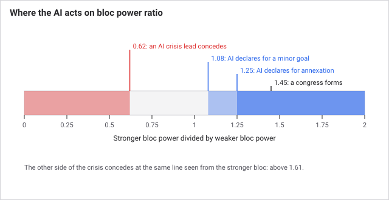
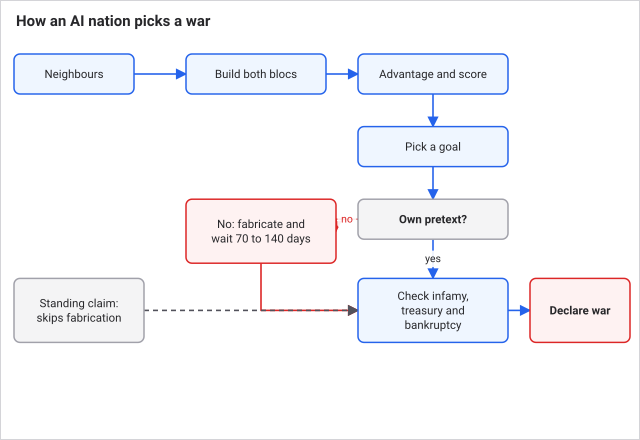
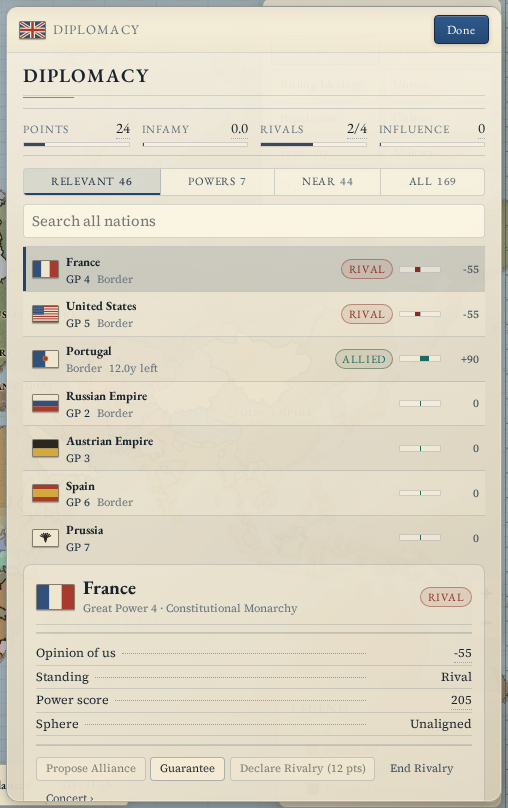
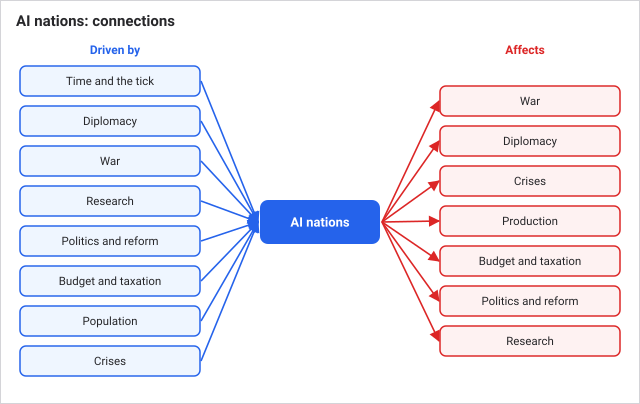
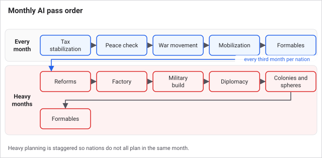

# AI nations

Every nation you do not run is an AI nation. They tax, build, research, fabricate pretexts, fight and make peace under mostly the same rules as you, once a month, after the rest of the world has moved. Knowing how they decide lets you predict who will attack you, who will fold in a crisis, and when to strike first.

## How it works

The AI pass runs last in the monthly order (see [Time and the tick](time-and-the-tick.md)). Each AI nation does its light work every month: set taxes, consider peace, move armies, mobilize if at war. Its heavy planning (reforms, factories, military build-up, new wars, colonies, influence) happens only every third month, staggered so different nations act in different months.

### How it sizes up the world

The AI judges everything by a **power estimate**: twice the full-strength regiments, plus 0.7 per ship, plus its treasury divided by 650, plus its population divided by 125,000, plus 0.28 times its prestige. A **bloc** (a nation and its allies) is the sum of its members. Nearly every decision is a ratio of two of these.

This is not the same as the great-power score in [Diplomacy](diplomacy.md), which is used for rankings and crises.

### Choosing a war

The AI only picks fights with **bordering** nations, and only if the numbers look good.

1. For each neighbour it forms both blocs (allies, plus guarantors on the defending side) and computes the **advantage**, its bloc power divided by theirs.
2. It scores each candidate: 43 times (advantage minus 1), plus hostility toward the target, plus 8 if they are rivals, plus the value of the best state to take, minus a fifth of the target's infamy.
3. It needs an advantage of at least 1.08. With no state worth taking, it needs 1.25.
4. It picks a goal that fits (below), then **fabricates a pretext** like you do, paying diplomatic points. It declares only when it holds one.

So an AI war is rarely a surprise: fabricating a pretext takes 70 to 140 days, and the AI checks for one only in its planning months. The exception is a standing claim (a lost core state, or a unification claim), which needs no preparation. A nation that is a candidate to unify also goes to war against the owners of its core states.

| If this is true | It picks |
|---|---|
| Best state is a colony it can reach | Take colony |
| Best state borders it and is worth over 8, advantage 1.25 | Annex state |
| Target is a rival or a rising rival | Cut down to size |
| It is a great power, the target is not, and the target's opinion of it is under -20 | Add to sphere |
| A valuable state is available at advantage 1.25 | Annex state |
| Nothing else | Humiliate |

It also holds back when its infamy is over 17.28, its treasury is under 380, or it is bankrupt.

### Fighting and peace

In war the AI sends armies toward the enemy capital, the states it wants, front-line provinces and its own threatened provinces. An army whose organization is under 18 or average strength is under 42% falls back toward safe, supplied ground. It makes at most 14 army moves a month, which is why it feels slow against your daily orders.

The AI asks for **white peace** when it is losing (score -18 or worse, exhaustion 58 or more, or a bloc under 82% as strong), when a war has stalemated for 4 years, or after 6 years regardless. It does not do this in the first 120 days unless things are already bad. When it is winning (score 32 or more) it asks for its goals instead, unless it is clearly ahead and can afford to wait.

### Diplomacy

An AI with a clear threat takes up to 2 allies, chosen by opinion, balance of power and shared borders with the threat. These last 9 years. It drops an ally that turns hostile (opinion -25 or worse), that is under 34% of its strength, or that it plans to attack. It also keeps one rival, preferring a neighbour of comparable strength, and drops it when the gap becomes extreme.

### Crises

In a [crisis](crises.md), an AI great power joins a bloc when its interest score reaches 45, based on opinion, alliances and rivalries. An AI lead that you have not pressed concedes early once the crisis is hot (temperature 50 to 99), before the deadline, if its bloc is below 0.62 times the other bloc's power. That means the other side must be more than 1.6 times stronger.

## Worked example

An AI nation has 30 full-strength regiments, 10 ships, a treasury of 3,900, 5 million people and prestige 40. Its power is 2 x 30 + 0.7 x 10 + 3,900 / 650 + 5,000,000 / 125,000 + 0.28 x 40 = 60 + 7 + 6 + 40 + 11.2 = 124.2.

Its neighbour's bloc, counting the neighbour's allies, comes to 100. The advantage is 1.24. That clears 1.08, so the neighbour is a candidate for a lesser goal such as humiliate. A war to annex a state needs 1.25, which it misses by a hair; one more ally would tip it.

## What you can do

The AI is not a panel you control, but you can read it and shape it.

- **Read power.** In the **Diplomacy** panel, a nation's dossier shows its power score split into industry and military, and its opinion of you.
- **Make yourself a poor target.** Keep your bloc above theirs. Alliances and guarantees both count toward your side's power, so a few friends can stop an attack before it is declared.
- **Hit tired armies.** An AI army falls back once its organization is under 18, so a battered stack is not a threat for long.
- **Win crises with strength.** The AI lead concedes at 0.62, so a clear lead in the Concert avoids war.
- **Check the truce.** A 5-year truce bars the AI from declaring on you, and from taking an alliance with you.

Tips:

- **Their research reveals their government.** Heavy army research means a reactionary or a nation near war. See [Research](research.md).
- **Count the allies.** The advantage ratio includes allies, so a lone neighbour is often safe to ignore and one with friends is not.

What the AI does not do: it has no hidden income, no free vision and no difficulty bonus. It does take a few shortcuts. It forms alliances directly, with no acceptance roll and no diplomatic points. It raises regiments at 75% cost and 90% strength and ignores the standing regiment cap.

Edge cases:

- **The AI is bankrupt.** It stops declaring wars and stops building armies and fleets.
- **No neighbours.** A nation with no land border never starts an ordinary war, but it still colonizes, and great powers still pursue spheres.
- **Your guarantee.** It counts toward the defender's bloc when the AI works out its advantage, so it can deter an attack. If the war comes anyway, you are in it.

## Connections

**Driven by:**
- [Events and decisions](events-and-decisions.md): AI nations resolve events and take decisions on their own.
- [The world market](the-world-market.md): prices guide what the AI builds and its tariff.

- [Time and the tick](time-and-the-tick.md): the AI pass runs last in each monthly update.
- [Diplomacy](diplomacy.md): the AI uses the same pretext, infamy, truce and relation rules.
- [War](war.md): the AI uses the same combat, supply and peace machinery.
- [Research](research.md): ruling ideology weights what the AI researches, and shapes its character.
- [Politics and reform](politics-and-reform.md): the ruling party sets which reforms the AI pursues.
- [Budget and taxation](budget-and-taxation.md): treasury and bankruptcy gate its wars and building.
- [Population](population.md): population and soldier pops set army size.
- [Crises and the Concert of Europe](crises.md): AI great powers decide whether to join a bloc and whether to concede.

**Affects:**

- [War](war.md): AI declarations and campaigns start and prosecute most wars you see.
- [Diplomacy](diplomacy.md): AI alliances, rivalries, spheres and pretexts reshape the map of relations.
- [Crises and the Concert of Europe](crises.md): AI choices decide which bloc forms and who backs down.
- [Production and industry](production-and-industry.md): the AI builds factories, favouring scarce goods.
- [Budget and taxation](budget-and-taxation.md): the AI sets its own tax and tariff rates between fixed limits.
- [Politics and reform](politics-and-reform.md): the AI enacts reforms toward its ruling party's positions.
- [Research](research.md): the AI's weighted choices give each nation its technology profile.

## Status

Live in every scenario and era, with no difficulty setting. Every nation not marked as the player's is AI-controlled. Which nations start as great powers, allies or rivals comes from the scenario.

Last checked: 2026-10-29, version 1.7.0

## Exact rules

Source `src/sim/systems/ai.ts` and `src/sim/balance.ts` (`BALANCE.ai`) unless noted. `runAiMonthly` runs last in the monthly block of `src/sim/world.ts`. Each AI nation runs: tax stabilization, peace check, war movement, mobilization if at war, formable pursuit. On a heavy month, `(floor(day / 30) + nation id) mod 3 = 0` (`heavyPlanningStride` 3), it also runs reforms, factory build, military build, diplomacy, colony and sphere actions, and formables again.

**Power estimate** (`estimateNationPower`): 2 x sum(regiment strength / 1000) + 0.7 x ships + max(0, treasury) / 650 + population / 125,000 + prestige x 0.28.

**War declaration** (`chooseWarTarget`, `maybeDiplomaticActions`). Candidates are bordering nations without truce or alliance. Advantage = attacker bloc power / defender bloc power. Score = (advantage - 1) x 43 + max(0, -opinion) x 0.2 - max(0, opinion) x 0.18 + 8 if rival + best state score - target infamy x 0.2. Needs advantage at least `warDeclareMinAdvantage` 1.08; with no target state, `warDeclareStrongAdvantage` 1.25. Blocked if infamy is over `warInfamyDeclareFactor` 0.96 x 18 = 17.28, treasury under `warTreasuryReserve` 380, bankrupt, or in income-negative bankruptcy, or infamy over 18 x 1.15 = 20.7. Declares only with a pretext and only if infamy plus the pretext cost is at most 18 x 1.32 = 23.76.

State score = 0.0007 x pop + 1.25 x resource level per province, +5.5 for each province bordering the attacker, +2.5 if all colonial, -2.2 if none borders.

Goal order: take colony (colonial state in reach, advantage 1.08), annex (bordering, state score over 8, advantage 1.25), cut down to size (rival, or defender prestige over 0.9 x attacker's and power over 0.85 x), add to sphere (great power versus non-great-power with opinion under -20, 1.08), annex (state score over 7.5, 1.25), else humiliate.

**Alliances and rivals** (`manageAlliancesAndRivalries`). The primary threat is the highest scorer among neighbours and rivals, needing 12: +14 neighbour, +14 x (their power / own), +0.08 x hostility, +10 rival, +0.25 x their infamy. With fewer than 2 allies and a threat, the best partner scores 0.55 x opinion + (17 - 0.22 x power gap) + 18 if it borders the threat + 14 if combined power exceeds 1.02 x the threat's; it must reach `allianceMinOpinion` 35. Signing adds 14 opinion and lasts 9 years. Break: opinion at or below `allianceBreakHostileOpinion` -25, ally power under `allianceBreakWeakPowerRatio` 0.34 x own (when it is not outmatched), or the ally is the planned target. With no rival it picks one scoring `rivalMinScore` 15 or more (comparable power 0.62 to 1.65, bordering +16, hostility 0.11 x). It drops a rival at power ratio under 0.45 or over 2.2, or opinion over 30.

**War conduct.** Retreat when average organization is under `warRetreatOrgThreshold` 18 or average strength under `warRetreatStrengthThreshold` 0.42. Move budget `warMoveBudgetPerMonth` 14. Each idle army heads for, in turn: its own capital if threatened, a threatened home province, an undefended enemy province next to it, or an objective (enemy capitals, goal states, front provinces).

**Peace** (`maybePeaceOut`). Losing: score at or below `peaceLoseScore` -18, or exhaustion at least `peaceExhaustionPush` 58, or own bloc under 0.82 x the enemy's. Stalemate: score within `peaceStalemateScoreBand` 9 for `peaceStalemateDays` 1,460. Forced exit at `peaceForceExitDays` 2,190. None of these apply while the war is under 120 days old, exhaustion is under 58 and score is above -35. Winning: score at least `peaceWinScore` 32, or at least `peaceScorePush` 26 with enemy exhaustion 58 or more and a power ratio of 0.95 or more. It holds out if its exhaustion is under `peaceHoldExhaustionMax` 72, the enemy's is under 90, its ratio is over 1, score is under 85 and the war is under 6 years.

**Economy.** Tax rates stay between `minTax` 0.10 and `maxTax` 0.80, tariffs between -0.25 and 0.35, aiming at a reserve of 1,200 (1,650 at war). Factory build cost is 220 plus 45 per factory in the state.

**Military build.** Desired army = max(2, floor(pop / 1000 x `baseArmyRatio` 0.022 x economy factor x 1.15 at war)), economy factor = clamp((treasury + 6 x income) / 4,500, 0.45, 1.4). Desired fleet = floor(pop / 1000 x `baseFleetRatio` 0.006 x economy factor + 5 for great powers). Builds need a treasury above 450. Regiments cost 75% and start at 90% strength.

**Colonies and spheres** (heavy months only). With 32 colonial points a nation has a 34% chance to pick a claim at random from its top 8 candidates. Great powers spend 1 influence on each of their top 3 scoring targets (score at least 8). A target takes a penalty of 40 when a rival with over 1.2 times the AI's power leads the influence race by 28 points or more.

**Crises.** `src/sim/systems/crisis.ts`: `JOIN_SCORE_THRESHOLD` 45, `AI_BACKDOWN_RATIO` 0.62 on summed great-power scores; congress when one bloc is 1.45 times the other or more (`SHOWDOWN_POWER_RATIO`).
