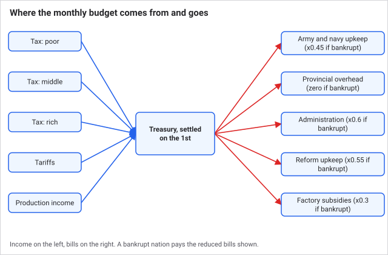
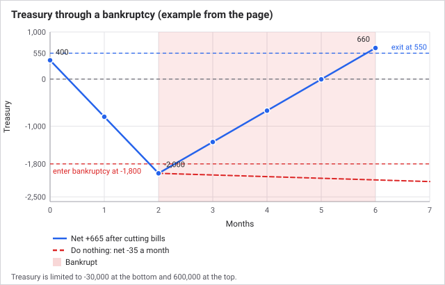
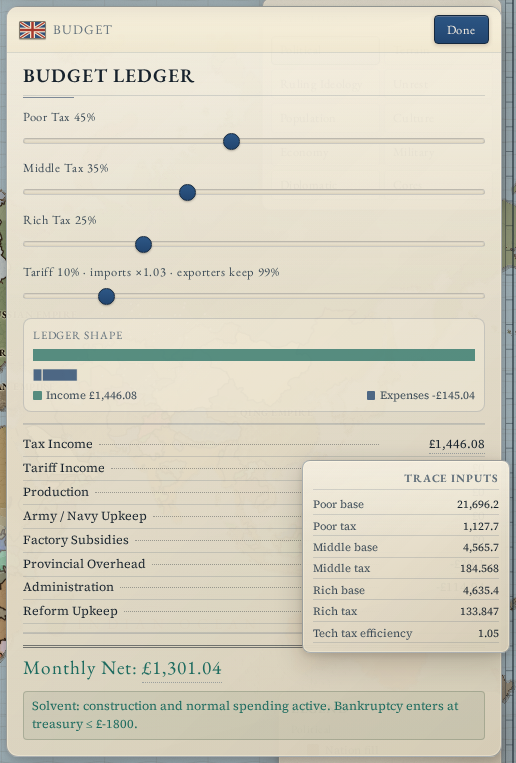
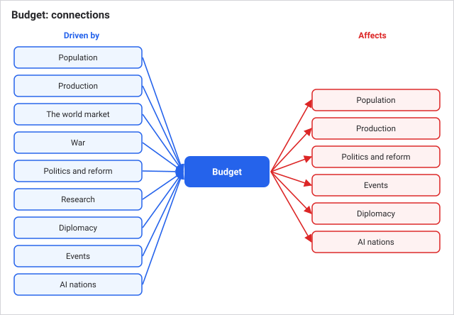

# Budget and taxation

Your treasury is settled once a month, on the 1st. The budget pass works out income and spending for every nation, applies the net to the treasury, and then checks whether you have gone bankrupt or recovered. Taxes, tariffs and the state's share of production come in; armies, administration, reforms and factory subsidies go out. One-off purchases such as factories, reforms and regiments come straight out of the treasury the moment you make them.

## How it works

### Income

**Taxes** are taken from the money pops are holding. There are three brackets, each with its own slider:

- **Poor:** farmers, laborers, craftsmen, soldiers and slaves.
- **Middle:** clerks, clergy and officers.
- **Rich:** aristocrats and capitalists.

Each month a pop pays its bracket's rate times 11% of the money in its purse. So a 45% slider takes 4.95% of what the pop holds, and even a 100% slider takes 11%. A pop that spent everything on food has little to tax, whatever the rate. Taxes do not cause unrest directly. They matter because money taken from a pop is money it cannot spend on its needs ([Population](population.md)).

**Tariffs** are collected through the month on every purchase and sale your economy makes and banked at the 1st. The tariff slider that earns this also raises your pops' cost of living ([The world market](the-world-market.md)). With a negative tariff the figure is negative: you are paying part of your pops' import bill.

**Production income** is the state's own cut of the economy: 8% of resource site sales, plus a small share of factory profit ([Production and industry](production-and-industry.md)).

### Spending

Spending mostly follows from what you own, not from discretionary choices:

- **Army and navy upkeep:** 2.5 per regiment and 1.7 per ship, every month, whether or not they fight.
- **Provincial overhead:** 0.75 per province for construction upkeep.
- **Administration:** 0.85 per province plus 0.00011 per person. A large empire costs more, and a crowded one more again.
- **Reform upkeep:** 4.2 per level of each reform enacted. Passed reforms are not free ([Politics and reform](politics-and-reform.md)).
- **Factory subsidies:** automatic support for loss-making plants, usually small ([Production and industry](production-and-industry.md)).

Province costs are scaled so a province in the standard 2,141-province world counts as about 0.18 of a reference province. Every province you take adds permanent administrative and overhead cost, productive or not.

One-off costs are separate from the monthly net. Mobilising an army costs 14 per regiment up front and 0.16 per regiment every day after ([War](war.md)). Building a factory, enacting a reform and recruiting regiments all spend treasury immediately.

### Bankruptcy

Bankruptcy is a state, not an event. You **enter** when the treasury is at or below -1,800 after a monthly pass. On entry you lose 4 prestige and construction is blocked. While bankrupt you lose 0.6 prestige every month, factory subsidies are paid at 30%, and your bills are cut: army upkeep to 45%, administration to 60%, reform upkeep to 55%, overhead to zero.

You **exit** when the treasury reaches 550 or more. The gap between -1,800 and 550 is deliberate: recovering means getting properly into the black, not scraping back over the line you fell through.

The cuts only shrink the bill. Nothing in the budget disbands your regiments or removes provinces. The lasting costs are prestige, blocked construction, and factories that lose their profit floor and can shrink ([Production and industry](production-and-industry.md)).

Treasury is held between -30,000 and 600,000 at the end of each month. Beyond the upper limit the extra is simply not kept.

| Item | Value |
| --- | --- |
| Tax sliders | 0% to 100%, one each for poor, middle, rich |
| Typical starting rates | 45% poor, 35% middle, 25% rich |
| Monthly tax take | rate x 11% of the pop's money |
| Army upkeep | 2.5 per regiment per month |
| Navy upkeep | 1.7 per ship per month |
| Provincial overhead | 0.75 per province |
| Administration | 0.85 per province + 0.00011 per person |
| Reform upkeep | 4.2 per reform level |
| Bankruptcy entry | treasury at or below -1,800 |
| Bankruptcy exit | treasury at or above 550 |
| Prestige lost | 4 on entry, then 0.6 per month |
| Treasury limits | -30,000 and 600,000 |

## A worked example

**A normal month.** In a test run of the 1830 campaign as the United Kingdom, the 1 February budget came out as:

- Income: taxes 1,589, tariffs 209, production 441, total 2,239.
- Spending: administration 107, provincial overhead 30, subsidies 2, army and navy 0, reforms 0, total 140.
- Net: +2,100, taking the treasury from 5,640 to 7,740.

The poor bracket supplied roughly three quarters of the tax. Administration of 107 is 73 for 666,000 people plus 34 for the province count (about 40 reference provinces).

**A bankruptcy, illustrated.** A nation starts a month with 400 in the treasury, income 1,000 and bills of army 1,200, administration 500, reforms 300, overhead 100 and subsidies 100 (2,200 total). Net is -1,200.

- Month 1: treasury 400 - 1,200 = -800. Month 2: -2,000, at or below -1,800, so it goes bankrupt and loses 4 + 0.6 = 4.6 prestige.
- From month 3 the bills fall to 540 + 300 + 165 + 0 + 30 = 1,035. Net is only -35. The cuts barely stop the bleeding, so it stays bankrupt.
- To get out it needs net of about +665: raise income or cut the army. Treasury -2,000 then rises to -1,335, -670, -5, and 660 in the fourth month after entry, which clears 550. Total prestige lost: 4 + 5 x 0.6 = 7.

## What you can do

Open the **Budget** panel (Economy group in the side rail), headed Budget Ledger.

- **Set the three tax sliders** and the tariff slider. The panel recalculates Monthly Net immediately, but the treasury only changes on the next 1st.
- **Read the ledger.** Lines: Tax Income, Tariff Income, Production, Army / Navy Upkeep, Factory Subsidies, Provincial Overhead, Administration, Reform Upkeep, and Monthly Net. Hover any figure for the numbers behind it, such as each bracket's money and tax. The Ledger shape bar compares income and spending at a glance.
- **Watch the bankruptcy line** under the ledger. It shows the entry and exit thresholds, and when bankrupt how many months you have been in it and the active cuts.

How to answer the usual questions:

- **Which bracket to raise?** Open the tax tooltip: it shows how much money each bracket holds. In the test run the poor bracket held most of the money because there are so many of them, but taking it removes the money those pops use to buy food. The rich bracket is a smaller pool, but those pops buy their food first and mostly hold the rest, so a tax there cuts luxury spending before it touches anyone's meals.
- **Why is the treasury falling when Monthly Net is positive?** Monthly Net covers only the recurring budget. Factories, reforms, regiments, ships, mobilisation and treasury costs on decisions all come out immediately. Tariff income also accrues across the month, so a mid-month reading understates it.
- **How do I escape bankruptcy?** Raise tax rates or tariff, demobilise armies, hold off on reforms, and sell reserve goods with a standing order ([The world market](the-world-market.md)). There are no loans and you cannot print money. Great powers with spheres of influence gain 6 a month per member ([Diplomacy](diplomacy.md)).
- **Do I lose provinces?** No. Bankruptcy has no territorial effect.
- **Do AI nations go bankrupt?** Yes, under the same rules. They adjust their taxes each month to stay near a reserve, between 10% and 80% for the poor and middle brackets ([AI nations](ai-nations.md)).

Tips:

- Conquest has a running cost. A war that doubles your territory doubles your administration and overhead bills every month thereafter.
- Reforms are an ongoing liability as well as a political choice.
- Act before the line. The exit threshold is 2,350 above the entry one.

## Connections

**Driven by:**

- [Time and the tick](time-and-the-tick.md): the budget runs first in the monthly pass, on the 1st.
- [Population](population.md): pops' money is the tax base and their head count drives administration.
- [Production and industry](production-and-industry.md): production income and the subsidy bill.
- [The world market](the-world-market.md): tariff income and import subsidies.
- [War](war.md): regiments and ships set army and navy upkeep, and mobilisation drains the treasury.
- [Politics and reform](politics-and-reform.md): each reform level adds upkeep, and enacting one costs treasury.
- [Research](research.md): commerce technologies capture more of the assessed tax.
- [Diplomacy](diplomacy.md): great powers earn a monthly income per member of their sphere.
- [Events and decisions](events-and-decisions.md): events and decisions can add or take treasury.
- [AI nations](ai-nations.md): AI nations reset their tax and tariff rates every month.

**Affects:**
- [War](war.md): the treasury pays for recruiting, mobilisation and upkeep.

- [Population](population.md): tax removes money from pops, so it lowers what they can buy and their needs met.
- [Production and industry](production-and-industry.md): bankruptcy blocks construction, switches off the factory profit floor and cuts subsidies.
- [Politics and reform](politics-and-reform.md): reforms need the treasury to cover their cost.
- [Events and decisions](events-and-decisions.md): decisions and some event choices need treasury to afford.
- [Diplomacy](diplomacy.md): prestige lost in bankruptcy lowers great-power ranking.
- [AI nations](ai-nations.md): AI planning keeps reserves and delays building and war when the treasury is low.

## Status

Live in every scenario with the same constants and for every nation, human or AI. Starting treasuries and tax rates differ by nation and scenario. Technologies that raise tax efficiency or trade efficiency change what you collect. There is no difficulty setting that changes the budget.

Last checked: 2026-10-29, version 1.7.0

## Exact rules

**When it runs.** `runBudgetMonthly` (`src/sim/systems/budget.ts`) is the first monthly system, on the 1st of each month, for every nation in nation order. The Budget panel uses `computePlayerBudget`, which recomputes the same figures without changing any money.

**Taxes.** Per pop: tax = min(money, money x clamp(rate, 0, 1) x 0.11 x (1 + `taxEfficiency`)), taken from the pop's purse. Bracket by type: rich = aristocrat, capitalist; middle = clergy, clerk, officer; poor = all others (farmer, laborer, craftsman, soldier, slave). Technology `taxEfficiency` adds a fraction (for example +0.05) to the multiplier. Starting rates are 0.45, 0.35 and 0.25 (`src/sim/bootstrap.ts`; 0.22 for rich in nations created by war, `src/sim/systems/war.ts`). Slider limits are 0 to 1 (`setTax`, `src/sim/commands.ts`).

**Tariff income.** Sum of tariff flows booked through the month in `monthlyTariffIncome` (signed), reset to 0 after the pass. Flow rules are in [The world market](the-world-market.md).

**Production income.** `monthlyProductionIncome`, reset to 0 after the pass, fed by: the state's 8% share of resource site sales; 3% of each factory's positive weekly profit and 2% of the state's positive total (`src/sim/systems/economy.ts`); and any owner share with no owner pops to receive it. Floored at 0 in the budget.

**Spending** (`src/sim/balance.ts`):

| Line | Formula | Constant |
| --- | --- | --- |
| Army | regiments x 2.5 | `armyUpkeepPerRegiment` |
| Navy | ships x 1.7 | `navyUpkeepPerShip` |
| Provincial overhead | provinces x province scale x 0.75 | `constructionSpendPerProvince` |
| Administration | people x 0.00011 + provinces x province scale x 0.85 | `adminSpendPerPopulation`, `adminSpendPerProvince` |
| Reform upkeep | sum of reform levels x 4.2 | `reformUpkeepPerLevel` |
| Subsidies | sum over factories of max(0, -weekly profit) x 3.6 | `src/sim/systems/budget.ts` |

Province scale = min(1, 387 / total provinces in the world) (`src/sim/geography.ts`), about 0.181 in the 2,141-province world. The Budget panel reports army and navy as one line.

**Bankruptcy.**

- Enter when not bankrupt and treasury <= -1,800 (`bankruptcyEnterTreasury`) after the net is applied: set `isBankrupt` and construction blocked, reset the month counter, prestige -4 (floored at 0).
- While bankrupt, every pass (including the entry pass): months +1, prestige -0.6 (floored at 0). Exit when treasury >= 550 (`bankruptcyExitTreasury`), clearing both flags. The exit pass still charges the 0.6.
- Bill multipliers while bankrupt: army and navy 0.45, administration 0.6, reform upkeep 0.55, subsidies 0.3, overhead 0 (it is also 0 whenever construction is blocked). Subsidies are credited to each plant's cash reserve at the same reduced amount.
- Net = tax + tariff + production - army and navy - subsidies - overhead - administration - reform.

**Treasury limits.** -30,000 (`treasuryFloor`) and 600,000 (`treasurySoftCap`), enforced for every nation at the end of the monthly AI pass (`keepValuesFinite`, `src/sim/systems/ai.ts`). Event and decision effects clamp separately to -25,000 and 5,000,000 (`src/sim/systems/events.ts`).

**Related one-off costs.** Mobilisation: 14 per regiment on raising (`src/sim/systems/war.ts`), then `MOBILIZED_UPKEEP_DAILY` 0.16 per mobilised regiment per day. Factories: 220 + 45 per existing factory in the state (`src/sim/commands.ts`). Reform enactment, regiment recruitment and ship building deduct their cost from the treasury at once.

**Diplomatic income.** Great powers (rank above 0) with sphere members gain 6 treasury per member per month in the diplomacy pass (`src/sim/systems/diplomacy.ts`).

**AI behaviour.** Each month AI nations set poor tax in the range 0.1 to 0.8, with middle and rich tracking a reserve target of 1,200 (1,650 at war) (`stabilizeEconomy`, `BALANCE.ai`, `src/sim/systems/ai.ts`).
