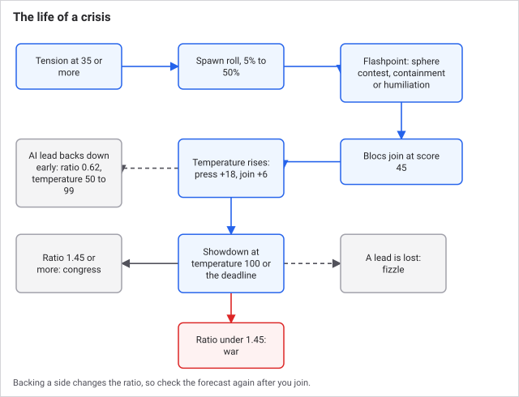
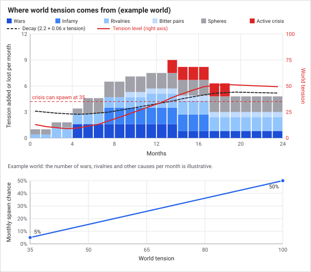
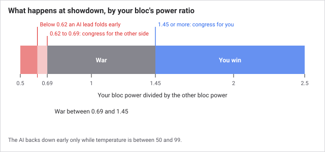

# Crises and the Concert of Europe

The great powers do not only fight the wars they choose. When world tension runs high, the game raises a **crisis** at a specific flashpoint: two great powers clash over a third nation, the others pick sides, and the confrontation ends in a peaceful congress or a bloc-versus-bloc war. A **great power** is one of the eight highest-scoring nations; only they can lead or join a crisis.

## How it works

Once a month, after [diplomacy](diplomacy.md), the crisis pass runs:

1. **Tension updates.** World tension (0 to 100) rises by the sum of its causes and falls by a decay of 2.2 + 6% of the current level.
2. **If a crisis is running,** it heats up, other great powers may join, and it may end.
3. **If not,** and tension is at least 35 and no cooldown is running, there is a monthly chance a crisis spawns.

*The world in the first panel is an illustration; the rates and caps are the game's.*

Tension has six causes, each capped, and you can see every one itemised by hovering over the tension number:

| Cause | Amount per month | Cap |
|---|---|---|
| Wars with a great power in them | 0.8 each | 4 |
| Nations at or past the infamy limit of 18 | 1.5 each, plus 0.1 per point over | 6 |
| Great-power rivalries | 0.4 each | 2.4 |
| Great powers with opinion of each other at -100 or worse | 0.3 per pair | 1.5 |
| Smaller nations pulled by two or more great powers | 0.6 each | 3 |
| A crisis already running | 1.5 | none |

A flashpoint is the best-scoring candidate of three kinds: a **sphere contest** (two great powers fight over a smaller nation), **containment** (the concert confronts a nation past the infamy limit), or **humiliation** (a hostile rivalry boils over). One great power presses a demand and another resists. Other great powers then join the side they favour when their score reaches 45 (from opinion, alliances and rivalries, minus 60 if the subject is their own client). You, as a great power, are never recruited automatically.

The crisis then gains temperature each month: 7 plus a random 0 to 5, plus 0.6 per great power on either side. It reaches a **showdown** when temperature hits 100 or the deadline passes (300 to 419 days after it begins). The outcome depends on **bloc power**, the sum of each member's great-power score, with a minimum of 1.

### Key numbers

| Item | Value |
|---|---|
| Starting world tension | 15 |
| Tension needed for a crisis to spawn | 35 |
| Monthly spawn chance | 5% at tension 35, rising to 50% at 100 |
| Join score | 45 |
| Congress threshold | One bloc at least 1.45 times the other |
| Temperature at start | 15 |
| Pressing a demand | +18 temperature, once per lead |
| Joining a side | +6 temperature |
| Cooldown before the next crisis | 540 days after a congress, 720 after a war, 240 after a fizzle, each plus 0 to 179 |

### Worked example

Two blocs reach showdown. The pressing bloc has a power of 120, the resisting bloc 90. Ratio is 120 / 90 = 1.33, under 1.45, so neither side is clearly stronger: the blocs go to war. If the pressing bloc had 140 instead, 140 / 90 = 1.56 and the weaker lead backs down at a congress. The stronger lead gains 10 + 0.1 x temperature prestige (at temperature 80, that is 18); the loser loses 8 + 0.08 x temperature (14.4).

## What you can do

Open **Great Powers** in the Statecraft group. The Concert of Europe card sits at the top of the panel. It shows tension with its breakdown, the active crisis with both blocs, the power ratio and a forecast ("If showdown now"), and a list of smoldering flashpoints before one spawns.

If you are a lead:

- **Press the Demand** adds 18 temperature once. It pushes the crisis toward showdown.
- **Back Down** ends the crisis at once. The other side wins a congress. You lose 8 + 0.08 x temperature prestige, but you avoid a war.

If you are another great power:

- **Back** either lead. It adds 6 temperature and your power to that bloc. It is blocked if a truce or war exists with the opposing lead.

Smaller nations cannot join. They can only be the subject.

Tips:

- To avoid a war, make one bloc clearly stronger before showdown, or back down early. Balanced blocs produce wars.
- Before a crisis spawns, you can lower tension: end a great-power war, bring infamy under 18, or settle a rivalry.
- Watch the forecast line. Backing a side changes the ratio, so check it again after you join.

An AI lead concedes early if its bloc is under 0.62 of the other (the other is more than about 1.61 times stronger) while temperature is between 50 and 99 and the deadline has not passed. That is a bigger gap than the 1.45 a congress needs, so the AI folds only when the position is clearly hopeless.

A crisis fizzles, with no winner, if the subject or a lead disappears, the pressing power loses great-power rank, or the leads end up at war with each other.

## Connections

**Driven by:**
- [Events and decisions](events-and-decisions.md): events can add infamy and shift opinion, which changes crisis standing.

- [Diplomacy](diplomacy.md): infamy, rivalries, opinion, spheres of influence and great-power rank set tension and pick the flashpoint
- [War](war.md): great-power wars add tension, and army and fleet strength make up bloc power
- [AI nations](ai-nations.md): AI great powers choose sides and back down
- [Population](population.md): industry (from pops and factories) is part of great-power score
- [Time and the tick](time-and-the-tick.md): the pass runs on the first of each month

**Affects:**

- [War](war.md): a failed crisis starts a war between the blocs
- [Diplomacy](diplomacy.md): leads lose opinion of each other, congresses can add a nation to a sphere, and war goals are applied
- [Politics and reform](politics-and-reform.md): prestige won or lost at congress pays for reforms
- [Culture and nationalism](culture-and-nationalism.md): prestige is also spent on accepting cultures
- [AI nations](ai-nations.md): crisis outcomes change what AI nations want

## Status

The rules are the same in every scenario, era and difficulty. A crisis needs at least two great powers and some tension, so a quiet world may go long stretches without one. 
Last checked: 2026-10-29, version 1.7.0

## Exact rules

All logic is in `src/sim/systems/crisis.ts`. Great-power score is in `src/sim/systems/diplomacy.ts`: `9 x sqrt(industry) + 2.5 x military + prestige`; the top 8 nations are great powers. The infamy limit is `INFAMY_LIMIT` (18) in the same file.

| Constant | Value |
|---|---|
| `SPAWN_TENSION_FLOOR` | 35 |
| `SHOWDOWN_POWER_RATIO` | 1.45 |
| `AI_BACKDOWN_RATIO` | 0.62 |
| `JOIN_SCORE_THRESHOLD` | 45 |
| `PRESS_TEMPERATURE` | 18 |
| `CONGRESS_HISTORY_CAP` | 16 records kept |
| Initial tension | 15 |

### Tension

`tension = clamp(tension + sum(contributions) - (2.2 + 0.06 x tension), 0, 100)`. Contributions: great-power wars `min(4, 0.8 x n)`; infamous nations `min(6, sum(1.5 + 0.1 x (infamy - 18)))`; great-power rivalries `min(2.4, 0.4 x n)`; great-power pairs with opinion -100 or less `min(1.5, 0.3 x n)`; contested spheres `min(3, 0.6 x n)` where a contested nation is a non-great-power with two or more great powers holding 25 or more influence points on it; active crisis +1.5. At rest, tension settles where contributions equal decay: `(contributions - 2.2) / 0.06`.

### Spawn

Needs tension of at least 35, no crisis, and the day past `crisisCooldownUntil`. Chance per month = `(tension - 35) / 65 x 0.45 + 0.05`. The top candidate by score is used:

- Sphere contest: challenger with 30 or more influence points against the incumbent; score is both influence totals, +15 if the target already has an owner sphere, minus 0.2 x leads' opinion. Demand: add to sphere.
- Containment: nation at or above the infamy limit with a great-power coalition against it; score `20 + 2 x (infamy - 18)`. Demand: cut down to size. The strongest coalition member leads.
- Humiliation: a rivalry with opinion -70 or worse; score `10 + 0.3 x (-opinion - 70)`. The stronger leads. Demand: humiliate.

Leads cannot be under a truce or already at war with each other. A new crisis cuts the leads' opinion by 15 and sets a deadline of 300 + 0 to 119 days.

### Monthly crisis step

1. Invalid crisis (subject or lead gone, attacker no longer a great power, leads at war): fizzle.
2. AI great powers not yet committed score the leads: `0.5 x (opinion of attacker - opinion of defender)`, +40 for an alliance with the attacker, -40 with the defender, -25 for rivalry with the attacker, +25 with the defender, -60 if the subject is their client. At +45 or more they join the attacker, at -45 or less the defender (not if a truce or war blocks it). Players join by command only.
3. Temperature += `7 + 5 x random + 0.6 x (all backers)`.
4. Early back-down: if temperature is 50 to 99 and the deadline has not passed, an AI lead (not a player) whose bloc is under 0.62 times the other concedes. A lead that has pressed the demand is excluded, but only players can press.
5. Showdown at temperature 100 or the deadline: congress for the attacker or defender if its bloc is at least 1.45 times the other, otherwise war.

### Outcomes

- **Congress.** Winner lead +10 + 0.1 x temperature prestige, loser lead -(8 + 0.08 x temperature), winning backers +2.5, losing backers -1. Leads' opinion -30. Tension -20. If the attacker won, the demand is applied as a war goal against the subject, except cut down to size, where the subject loses 12 prestige and the attacker gains 2 (no demotion without a war). Cooldown 540 + 0 to 179 days.
- **War.** One war between the sides (backers on both sides excluded from both). Goals: attacker's demand against the subject, defender's humiliate against the attacker. The attacker gains half the usual infamy for the demand. Tension -35. Cooldown 720 + 0 to 179 days.
- **Fizzle.** Tension -8. Cooldown 240 + 0 to 179 days.

### Player commands

`crisisBackSide` needs great-power rank, no existing side, and no truce or war with the opposing lead. `crisisPressDemand` and `crisisBackDown` are for leads only; press works once per lead.
