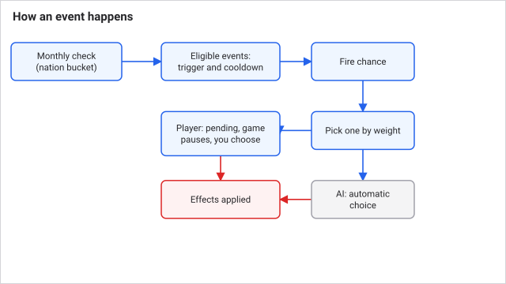
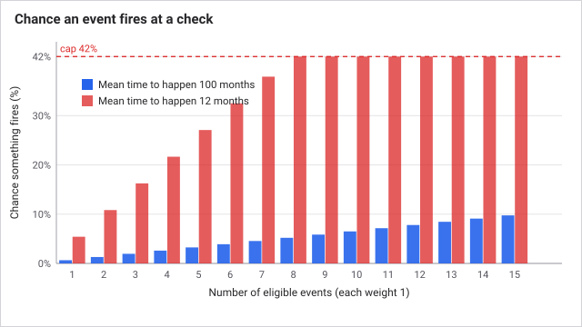
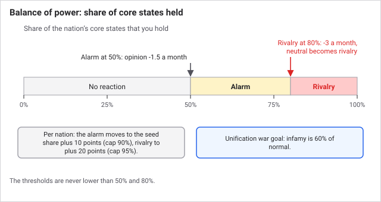
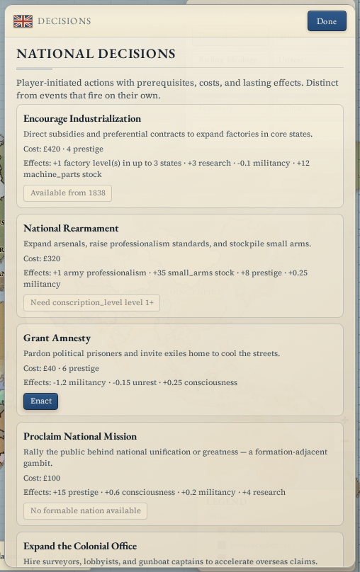

# Events and decisions

Events and decisions are the game's narrative layer, and both change real numbers. An **event** happens to you: the game finds one whose conditions your nation meets, pauses, and asks you to pick a response. A **decision** is the opposite: a standing option you choose to take when you can afford it. A third system rides alongside, **balance of power**, which makes the other great powers turn on a nation that gets close to unifying.

## How it works

Once a month, after [crises](crises.md), the game checks events for a share of nations. Nations are split into six groups by number, and one group is checked each month, so each nation is checked once every six months. For a nation that is checked:

1. Every event is tested. It must not be on cooldown, and its **trigger** (conditions such as year, government type, treasury, literacy, average militancy or needs) must be true of your nation.
2. The chance that anything fires is 65% of the sum of each eligible event's weight divided by its **mean time to happen** (the average number of months it would take), capped at 42%.
3. If it fires, one event is picked by weight.
4. For you, the event becomes **pending**, the game pauses, and a dialog shows the choices. AI nations pick one immediately.

Each choice lists **effects**. They are the same effects everything else uses: treasury, prestige, infamy, militancy, consciousness, literacy, research, reform levels, unrest, goods prices and stockpiles, opinion of other nations, free casus belli (a legal reason to declare war), and others. A choice can also have its own requirement, such as a minimum treasury, and shows greyed out with the reason if you do not meet it.

### Key numbers

| Item | Value |
|---|---|
| Events in the game | 26, of which 3 can only ever happen once |
| Decisions in the game | 13, of which 6 can only be taken once |
| How often a nation is checked | Once every 6 months |
| Maximum chance something fires at a check | 42% |
| Pending events held for you at once | 3 |
| Usual cooldown after an event | Half its mean time to happen, at least 24 months, or a set value |
| Money gained from one effect | At most 800 |
| Money lost to one effect | At most 35% of your treasury plus 80, never below 40 |
| Balance of power alarm | 50% of unification cores held (more if you start with many) |
| Balance of power rivalry | 80% of cores held (more if you start with many) |
| Opinion lost per month, alarm / rivalry | 1.5 / 3 per other great power |

### Worked event

Springtime of Nations needs the year to be 1848 to 1852, a civilized government and average militancy of 3.2 or more. It happens once. With weight 2.4 and mean time to happen 4, its weight share is 0.6, so the fire chance at a check is 0.6 x 0.65 = 39% if it is the only eligible event. The choices:

| Choice | Effects |
|---|---|
| Crush the demonstrations | -£180, -8 prestige, +1.4 militancy, -0.4 consciousness, +0.18 unrest |
| Concede liberal reforms | Voting Franchise +1, Press Rights +1, -£90, -12 prestige, -1.8 militancy, +0.8 consciousness |
| Bargain with notables | -£240, Press Rights +1, -0.9 militancy, +4 prestige |

An event that raises a reform level skips the upper house vote, the cost and reform fatigue. That is why an event can be a shortcut, and why conceding is a different thing from [enacting](politics-and-reform.md).

### Worked decision

Encourage Industrialization needs a civilized government, £450 in the treasury, the year 1838 or later and at least one factory. It costs £420 and 4 prestige. It adds one factory level in up to three of your states, 3 research points, 12 machine parts to the world stockpile and -0.1 militancy. You can take it again after 84 months.

### Balance of power

When a great power holds enough of the core states of a formable nation (a unified state it could proclaim), the other great powers react. Each month, every other great power that is not an ally and not itself a candidate for that formable loses opinion of the climber: 1.5 at the alarm share, 3 at the rivalry share, never going below -140. At the rivalry share a neutral relationship turns into a rivalry.

The alarm and rivalry shares are 50% and 80% of the core states, but a nation that starts with a big slice is not punished for the map. Its alarm share is its starting share plus 10 points (at most 90%), and its rivalry share is its starting share plus 20 points (at most 95%). A nation starting with 10 of 13 cores (77%) sets off alarm at 87% and rivalry at 95%.

This counterweights unification: [diplomacy](diplomacy.md) makes unification war goals cost 60% of the usual infamy (a 40% discount), and balance of power makes the existing powers resent you more the closer you get.

## What you can do

- **Answer an event.** The dialog appears when it fires and the game pauses. Each choice shows its effects. Pending events do not expire and no timer forces a choice. The dialog stays on screen until you answer. Up to 3 can queue.
- **Take a decision.** Open **Decisions** in the Statecraft group (the panel title is "National Decisions"). Each row shows cost, effects, and a button that reads "Enact", or the reason you cannot. Some decisions are national arcs for one country only, and other nations never see them. Arcs show progress and the next unlock.
- **Watch balance of power** in the **Formables** panel. A line appears once you pass the alarm share, showing your progress, how many great powers are alarmed, and the monthly opinion loss.

Why do I keep getting this event? Events follow your situation, so a pile of unrest events means your average militancy keeps passing their trigger. Events that repeat wait for their cooldown first.

Can I ignore an event? Not really: it stays pending until you pick, and every option changes something, so even the cheapest one has a cost.

Tips:

- Read the effects line under each choice, not just the story text.
- Take decisions with long cooldowns early if they pay for themselves, such as Encourage Industrialization.
- When you near a unification, check the balance of power line before taking the last core state.

## Connections

**Driven by:**

- [Politics and reform](politics-and-reform.md): reform levels, literacy and militancy are event requirements
- [Population](population.md): average militancy and needs met trigger events
- [Budget and taxation](budget-and-taxation.md): treasury sets which events and decisions are available and what they can cost
- [Diplomacy](diplomacy.md): great-power rank and unification claims decide what balance of power targets
- [Time and the tick](time-and-the-tick.md): events run monthly and many are gated by year
- [Research](research.md): research points are a cost and reward for decisions

**Affects:**

- [Politics and reform](politics-and-reform.md): events can raise reform levels, add unrest or change militancy
- [Population](population.md): militancy and consciousness change
- [Budget and taxation](budget-and-taxation.md): treasury gains and losses
- [Production and industry](production-and-industry.md): factory and raw-goods output boosts
- [The world market](the-world-market.md): price changes and stockpile changes
- [Diplomacy](diplomacy.md): opinion changes, rivalries, casus belli, and balance of power pressure
- [War](war.md): events can spawn rebels or grant a reason to declare war
- [Research](research.md): research point rewards
- [Crises and the Concert of Europe](crises.md): the other way the world reacts to a rising power
- [AI nations](ai-nations.md): AI nations resolve events and take decisions on their own

## Status

The rules are the same in every scenario, era and difficulty. The content is not: events are limited by year, and the national arc decisions (the Prussian and Italian unification chains) are tied to particular countries. Pressure from balance of power only applies when the nation near unification is itself a great power.

Last checked: 2026-10-29, version 1.7.0

## Exact rules

Engine: `src/sim/systems/events.ts`. Content: `src/data/events.ts`, `src/data/decisions.ts`. Runs in the monthly pass after crises (`src/sim/world.ts`).

| Constant | Value |
|---|---|
| `STAGGER_BUCKETS` | 6 |
| Fire chance | `clamp(0.65 x sum(weight / mtth), 0, 0.42)`, weight default 1, mtth at least 1, each term at least 0.01 |
| Cooldown | `cooldownMonths`, or `max(24, floor(mtth x 0.5))` |
| Pending cap | 3 per nation |
| AI event gate | Treasury at least 140 |
| `TREASURY_MIN` / `TREASURY_MAX` | -25,000 / 5,000,000 |
| Treasury gain cap | 800 per effect |
| Treasury loss cap | `max(40, 0.35 x abs(treasury) + 80)` per effect |
| `AI_DECISION_CHANCE` | 0.22 per check, civilized only |
| `AI_TREASURY_FLOOR` | 900, and a decision cost cannot exceed 25% of treasury |
| `BOP_ALARM_SHARE` | 0.5 |
| `BOP_RIVALRY_SHARE` | 0.8 |
| Pressure | 1.5 at alarm, 3 at rivalry; opinion floor -140 |
| Seed share offsets | alarm: `min(0.9, max(0.5, seed + 0.1))`, rivalry: `min(0.95, max(0.8, seed + 0.2))` |
| `UNIFICATION_INFAMY_DISCOUNT` | 0.6 (war goal infamy is multiplied by it), in `src/sim/systems/diplomacy.ts` |

### Events

A nation is skipped if it owns no provinces. At most one event fires per nation per check. A trigger can test year range, civilized status, great-power status, country tag lists, decisions taken, treasury, literacy, average militancy, average needs met, factory count, adjacent uncolonized land and a formable candidate. A choice can add requirements (minimum treasury, prestige, colonial points, literacy, factories, reform at most or at least, year). Requirements are checked again when you choose.

Player events set the game speed to 0 when they fire. AI nations pick the available choice with the highest `aiWeight` (default 40), minus 25 for a drain over 100 while treasury is under 250, minus 15 for spawning rebels, plus up to 12 random.

Effect limits: reform levels clamp to 0 to the reform's maximum and add no fatigue; militancy and consciousness clamp 0 to 10 for every pop; unrest is added to every state's unrest risk (clamp 0 to 2); infamy 0 to 100; prestige 0 to 10,000; literacy 0 to 1; goods price factor clamp 0.4 to 2.5 within 0.3 to 3.5 times base price; stockpile 0 to 50,000; factory and raw-goods boosts clamp the level to 1 to 12, up to 3 states and 4 provinces; rebels are 3 regiments of 850 in the most militant state, only if fewer than 2 rebellions are active against you; opinion clamps to -200 to 200.

### Decisions

`evaluateDecision` returns unavailable, in this order, if: already taken (once-only); on cooldown; a prerequisite fails; treasury or prestige is short. Taking one pays treasury, prestige and research point costs and applies its effects. Tag-locked decisions are hidden from other countries (`listPlayerDecisions`). The arc chains are Zollverein, German Question, Brothers' War, and Risorgimento, French Entente, Expedition of the Thousand, Roman Question.

### Balance of power

`applyBalanceOfPowerPressure` runs first in the events pass. For each great power and each formable it has cores in, at or above its alarm share, every other great power that is not an ally and not a candidate for that formable gets `opinion -= 1.5` (3 at the rivalry share), with a neutral relation becoming a rivalry at -40 or worse. The readout (`getPlayerBalanceOfPowerView`) is shown for the formable with the highest core share and is also shown to non-great-powers, though only great powers cause pressure.
