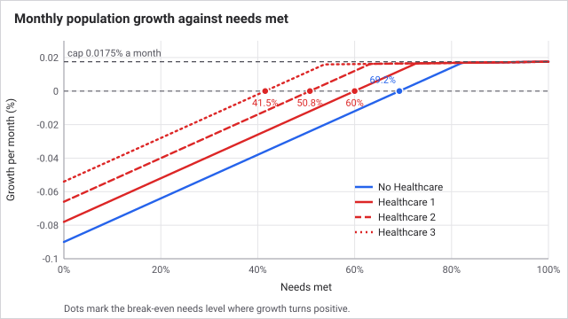
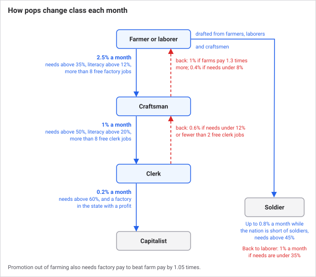
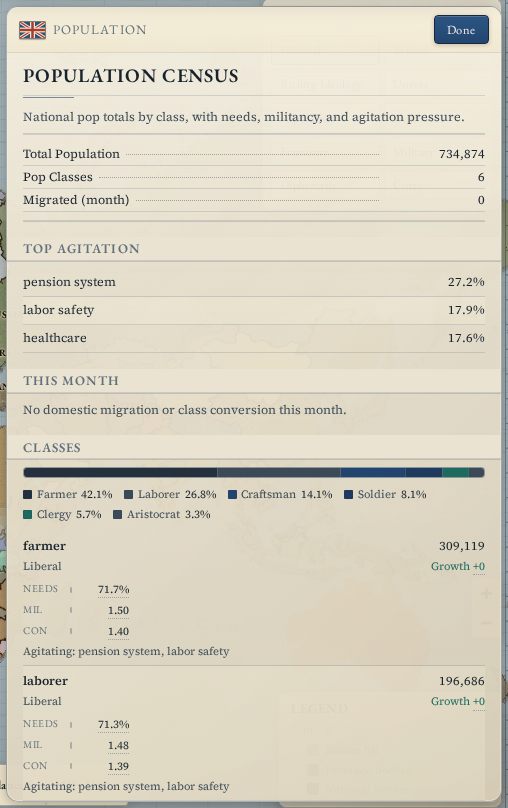
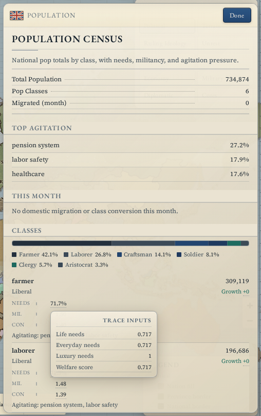
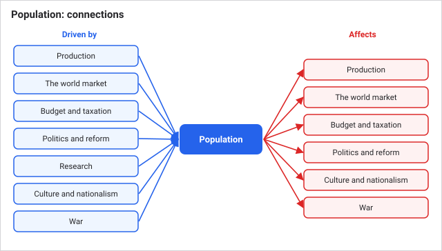

# Population

Your nation is not one number. It is a collection of **pops**, groups of people living in one province, each with a class and occupation (the pop's type), a culture, a size and a purse of its own money. Pops earn, shop, grow, change class and move. Almost every other system either feeds them or is fed by them, and the single most important number attached to a pop is **needs met**: how well it is fed and supplied.

## How it works

**Every week, each pop earns and then shops.** Income has two parts: a small passive income set by its type and size, and wages from the factory or resource site that employs it ([Production and industry](production-and-industry.md)). Then the pop buys its needs in three tiers, strictly in this order:

1. **Life needs:** grain, cattle and fish.
2. **Everyday needs:** timber, plus fabric for most town classes.
3. **Luxury needs:** furniture, wine, clothes and so on, depending on class.

A pop buys as much of each tier as its money allows before it moves to the next one. A pop that cannot afford food never reaches everyday goods or luxuries, however rich the nation is. Prices come from [the world market](the-world-market.md), plus your tariff.

**Needs met** is a running average. Each week it moves 40% of the way toward this week's result, where this week's result counts life needs at 72% and everyday needs at 28%. Luxuries do not count toward it. So a pop that gets all its food and nothing else settles at 72%.

**Every month, pops grow, change class and migrate.** Growth depends mainly on needs met, plus small bonuses from the Healthcare reform and medicine technologies:

| Needs met | Monthly growth rate | Change for a 100,000-person pop |
| --- | --- | --- |
| 40% | -0.038% | -38 |
| 60% | -0.012% | -12 |
| 69.2% | 0% | 0 |
| 80% | +0.014% | +13 |
| 90% | +0.017% | +17 |
| 100% | +0.0175% (the cap) | +17 |

Growth is slow on purpose: a century of play should reshape a nation by moving people between classes and provinces, not by explosive births. At best a pop grows about 0.2% a year. The break-even point is 69.2% needs met, and each level of the Healthcare reform lowers it (60.0%, 50.8% and 41.5% at levels 1, 2 and 3). Small random noise moves the monthly figure by up to 0.005 percentage points either way.

**Class changes follow jobs and wages, not a timer.**

| Move | Needed |
| --- | --- |
| Farmer or laborer to craftsman | 2.5% of the pop per month, if needs met is above 35%, national literacy above 12%, and the state has more than 8 free factory jobs. Blocked while the land pays better (see below) |
| Craftsman to clerk | 1% per month, needs above 50%, literacy above 20%, and more than 8 free clerk jobs in the state |
| Clerk to capitalist | 0.2% per month, needs above 60%, and a factory in the state with positive profit |
| Craftsman back to laborer | 0.4% per month if needs are below 8% or the state has fewer than 2 free factory jobs; 1% per month if farms pay at least 30% more than factories |
| Clerk back to craftsman | 0.6% per month if needs are below 12% or fewer than 2 free clerk jobs |
| Farmer, laborer or craftsman to soldier | Up to 0.8% of the pop per month while the nation is short of soldiers, only for pops of an accepted culture with needs above 45% |
| Soldier back to laborer | 1% per month if needs are below 35% |

The farm-to-factory gate is the labour market at work. The game compares realised weekly pay per 1,000 workers on the farm side and the factory side. If a province's farms have free jobs and pay more than 1.05 times the factory rate, farmers stay put. If farms pay more than 1.3 times the factory rate, craftsmen drift back to the land. This stops the countryside emptying when raw goods turn scarce and farm wages rise.

The soldier target is 4.5% of national population, plus 1.5 percentage points for each level of Army Professionalism ([Politics and reform](politics-and-reform.md)). If the nation has fewer soldiers than that target, farmers, laborers and craftsmen are drafted up to the shortfall.

**Migration** moves farmers and laborers only. Each month every province is scored by its average needs met plus a bonus for job openings (up to +0.45 at 2,250 openings). Each nation picks its best-scoring province with more than 50 openings. A pop of more than 250 people in a worse-off province moves 0.8% to 4% of its people there, if that province scores more than 0.08 better. Migration is movement toward work, so population concentrates where jobs are.

**Urbanization** is a state's total factory levels divided by 10 for every province-equivalent it holds. It is a result of industry, not a setting, and it raises consciousness (see [Politics and reform](politics-and-reform.md)).

## A worked example

A craftsman pop of 10,000 people needs, each week, 2.9 grain, 1.9 cattle and 0.9 fish (5.7 units). At base prices (2.2, 2.4, 2.3, no tariff) that costs 6.38 + 4.56 + 2.07 = 13.01. Suppose the pop has only 9.10 to spend, 70% of that cost.

- It buys grain first (all 2.9 units, 6.38 spent), then cattle with the remaining 2.73, which buys 1.14 of 1.9 units. Nothing is left for fish.
- Life needs are filled at (2.9 + 1.14) / 5.7 = 71%. Everyday goods are not reached. This week's score is 0.72 x 0.71 = 0.51.
- Starting from 90% needs met, the average slides to 74%, 65%, 59% and 56% over four weeks, heading toward 51%.
- At 56% needs met the monthly rate is -0.0172%, so a 100,000-person pop of this kind loses 18 people a month (the loss rounds up). Militancy rises too, which feeds unrest ([Politics and reform](politics-and-reform.md)).

The fix is more money or cheaper food, not more luxuries.

## What you can do

You do not command pops directly. You change the conditions they live in. The **Population** panel (Economy group in the side rail) shows total population, a class breakdown, the month's migration and class moves, and for each class: monthly growth, needs met (hover for life, everyday and luxury shares and the scarcest goods), militancy, consciousness and which reforms it is agitating for. Hover over Growth to see the drivers.

- **Pops shrinking?** Open Population and hover the Needs bar for the scarce goods. Then fix supply (more farms or fisheries, a Fishing Wharf on a coast), price (lower your tariff in the Budget panel) or income (lower the poor tax, build factories that employ them).
- **Not promoting?** Check literacy (technologies raise it, see [Research](research.md)), whether the state has free factory or clerk jobs, and whether pay on the farm beats pay in the factory.
- **Pushing growth up:** enact Healthcare in the Politics panel. Each level lowers the needs level at which a pop stops shrinking.
- **Wanting more soldiers:** raise Army Professionalism. Soldiers are drawn from your own farmers, laborers and craftsmen, so recruiting takes workers from the economy.
- **Foreign cultures:** pops of a culture your nation does not accept are never drafted ([Culture and nationalism](culture-and-nationalism.md)).

Tips:

- Feed first. A pop that cannot buy food buys nothing else, so luxury industries starve and growth stalls.
- You cannot promote your way to an industrial economy. Build and staff the factories first and the clerks and capitalists follow.
- Expect people to pile into your best provinces. That is migration working, not a bug.

## Connections

**Driven by:**
- [Events and decisions](events-and-decisions.md): events change militancy and consciousness.

- [Time and the tick](time-and-the-tick.md): income and shopping run weekly, growth, class changes and migration run monthly.
- [Production and industry](production-and-industry.md): wages, job openings and urbanization come from resource sites and factories.
- [The world market](the-world-market.md): prices and your tariff decide how far a pop's money goes.
- [Budget and taxation](budget-and-taxation.md): monthly tax takes money out of pops' purses.
- [Politics and reform](politics-and-reform.md): Healthcare changes growth, Army Professionalism sets the soldier target, reforms relieve or raise militancy.
- [Research](research.md): technologies raise literacy and add a small growth bonus.
- [Culture and nationalism](culture-and-nationalism.md): assimilation moves people between cultures, and only accepted cultures are drafted.
- [War](war.md): mobilised regiments cut civilian needs met.

**Affects:**
- [AI nations](ai-nations.md): a nation's population and size feed the AI power estimate.
- [Crises and the Concert of Europe](crises.md): population is part of the power estimate that decides who backs down.
- [Events and decisions](events-and-decisions.md): average militancy and needs met trigger events.

- [Production and industry](production-and-industry.md): pops are the workforce and supply the owners who receive profit.
- [The world market](the-world-market.md): pops are the consumers whose shopping creates demand.
- [Budget and taxation](budget-and-taxation.md): their money is the tax base and their head count drives administration costs.
- [Politics and reform](politics-and-reform.md): unmet needs raise militancy and unrest, and consciousness and ideology feed reform demands and elections.
- [Culture and nationalism](culture-and-nationalism.md): pop sizes, militancy and consciousness feed the culture figures.
- [War](war.md): soldier pops are the recruiting pool.

## Status

Live in every scenario. The rules and constants are identical in all of them. What differs is the starting map: each scenario seeds its own pops, so a 1914 start begins with different sizes, classes and culture mixes than 1830. There is no difficulty setting that changes population rules.

Last checked: 2026-10-29, version 1.7.0

## Exact rules

**Pop types** (10): aristocrat, capitalist, clergy, clerk, craftsman, farmer, laborer, soldier, officer, slave (`src/shared/types.ts`).

**Weekly pass** (`runPopsWeekly`, `src/sim/systems/pops.ts`), after production registers supply and before stockpile orders and settlement.

- Passive income per week = (size / 1000) x rate x 1.7 (`passiveIncomeScale`). Rates: aristocrat 3.2, capitalist 2.4, clergy 1.8, officer 1.8, clerk 1.5, soldier 1.1, slave 0.4, all others (farmer, laborer, craftsman) 0.4.
- Expectation multiplier on everyday and luxury quantities = 1 + consciousness x 0.06 (`expectationPerConsciousness`), so up to +60% at consciousness 10. Life needs are not scaled.
- Hoard appetite = clamp(money / (base basket cost x 26), 1, 8). Everyday goods are bought up to min(appetite, 3) times the base amount, luxuries up to appetite times. Fill fractions are measured against the base amount, so a rich pop does not "over-meet" a need.
- Combined needs = 0.72 x life fraction + 0.28 x everyday fraction. Luxury fraction is tracked but not included.
- `needsMet` = 0.6 x previous + 0.4 x combined (`weeklyNeedsPreviousWeight`, `weeklyNeedsCurrentWeight`), clamped 0 to 1.
- Pops buy in list order. When a good runs out, later pops in the list get less.
- Weekly militancy change = (1 - needsMet) x 0.025 - needsMet x 0.05 (`weeklyMilitancyFromUnmet`, `weeklyMilitancyFromMetRelief`), clamped 0 to 10.
- Weekly consciousness change = literacy x 0.03 + urbanization x 0.02 + luxury fraction x 0.01 - (1 - needsMet) x 0.01, clamped 0 to 10.

**Needs per 1,000 people per week** (`POP_NEEDS`, `src/data/gameData.ts`):

| Type | Life | Everyday | Luxury |
| --- | --- | --- | --- |
| Farmer | grain 0.36, cattle 0.2, fish 0.1 | timber 0.08 | furniture 0.02, wine 0.01, fertilizer 0.015 |
| Laborer | grain 0.35, cattle 0.22, fish 0.1 | timber 0.09 | furniture 0.03, wine 0.01, clothes 0.015 |
| Craftsman | grain 0.29, cattle 0.19, fish 0.09 | timber 0.08, fabric 0.05 | furniture 0.05, wine 0.03, clothes 0.03 |
| Clerk | grain 0.27, cattle 0.18, fish 0.08 | timber 0.07, fabric 0.06 | furniture 0.06, wine 0.04, paper 0.025, clothes 0.02 |
| Capitalist | grain 0.22, cattle 0.14, fish 0.08 | timber 0.07, fabric 0.08 | furniture 0.1, machine parts 0.02, glass 0.03, cement 0.02 |
| Aristocrat | grain 0.22, cattle 0.16, fish 0.08 | timber 0.07, fabric 0.08 | furniture 0.11, artillery 0.01, glass 0.04, wine 0.02 |
| Clergy | grain 0.28, cattle 0.18, fish 0.09 | timber 0.07, fabric 0.05 | furniture 0.04, wine 0.02, paper 0.02 |
| Soldier | grain 0.36, cattle 0.23, fish 0.1 | timber 0.08, fabric 0.04 | wine 0.02, canned food 0.03, ammunition 0.02 |
| Officer | grain 0.28, cattle 0.18, fish 0.09 | timber 0.07, fabric 0.06 | wine 0.05, small arms 0.02, ammunition 0.015 |
| Slave | grain 0.31, cattle 0.18, fish 0.08 | timber 0.05 | none |

Prices for these goods: grain 2.2, cattle 2.4, fish 2.3 (`GOODS`, same file). Every purchase also pays your tariff multiplier ([The world market](the-world-market.md)).

**Monthly pass** (`runPopsMonthly`), second in the monthly order after the budget.

- Growth rate per month = clamp(-0.0009 + needsMet x 0.0013 + healthcare level x 0.00012 + technology bonus + noise, -0.006, cap), with noise = (random - 0.5) x 0.0001 and cap = min(0.00022, 0.00014 + needsMet x 0.000035). In practice the cap is 0.000175 at full needs. Size change = floor(size x rate), so a negative rate always rounds toward the larger loss. Source constants: `minGrowthRate` -0.006, `maxGrowthRate` 0.00022 (`src/sim/balance.ts`). The break-even needs level is (0.0009 - 0.00012 x healthcare level) / 0.0013.
- Monthly consciousness change = literacy x 0.11 + urbanization x 0.035 - (1 - needsMet) x 0.012.
- Monthly militancy change = (0.47 - needsMet) x 0.05 - needsMet x 0.06 (`monthlyMilitancyBaseline`, `monthlyMilitancyPressure`, `monthlyMilitancyDecay`).
- Ideology drifts slowly by chance each month, with elite classes (aristocrat, officer, clergy) resisting radical drift almost entirely (`ideology*` constants, `src/sim/balance.ts`).
- Only pops that exist at the start of the month are processed.
- Urbanization = clamp(total factory levels in the state / max(1, provinces in state x 10 x province scale), 0, 1). Province scale = min(1, 387 / province count in the world) (`src/sim/geography.ts`).

**Class changes**: rates and conditions in the table above come straight from `runPopsMonthly`. Thresholds: `promoteWageAdvantage` 1.05, `demoteWageAdvantage` 1.3, `demoteReturnRate` 0.01 (`src/sim/balance.ts`). A province's farm holds its workers only if free RGO jobs exceed 50 and RGO pay per 1,000 workers exceeds factory pay per 1,000 times 1.05. Capacities used: factory jobs = 2,300 per level, clerk jobs = 20% of capacity, RGO jobs = 4,200 per level.

**Soldier target**: share = 0.045 + 0.015 x Army Professionalism level, times national population, minus current soldiers. A conversion needs demand above 20.

**Migration**: province score = average needs met + clamp(openings / 5000, 0, 0.45); eligible destinations need more than 50 openings. Moving fraction = clamp(0.012 + (score gap) x 0.02, 0.008, 0.04), applied to farmer and laborer pops over 250 people when the gap exceeds 0.08.

**Edge cases.** A pop of zero size is reset to zero needs met and skipped. Growth never takes a pop below zero. Mobilised armies subtract 0.000007 needs met per regiment per day from civilian pops of the owner (`src/sim/systems/war.ts`).
