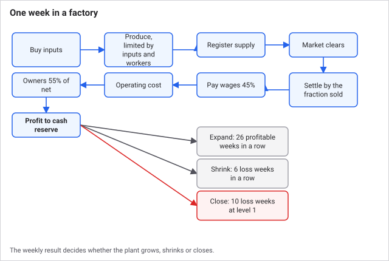
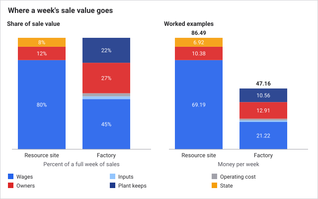
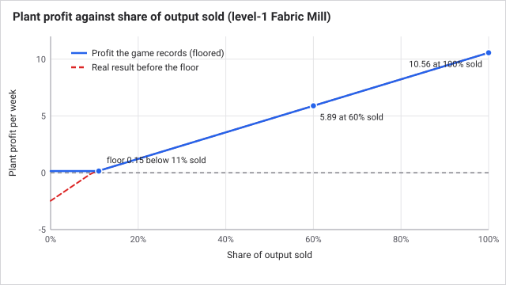
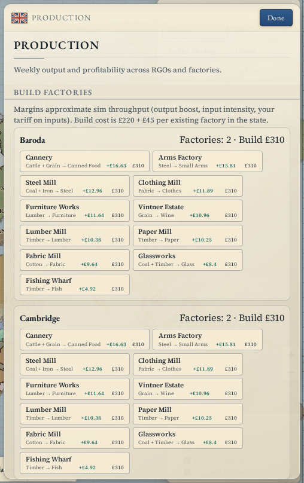
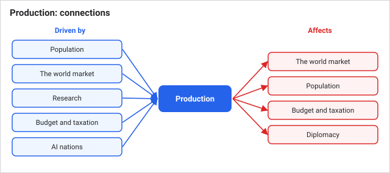

# Production and industry

There are two kinds of producer in Grand Century. **Resource sites** (called RGOs, short for resource gathering operations) are farms, mines and camps that pull a raw good out of a province. **Factories** buy inputs and turn them into finished goods. Both run on the weekly pass, both employ pops, and both only earn money for the part of their output that actually sells. Production is where the economy's supply, jobs and wages come from.

## How it works

### Resource sites

Every province has one resource site, fixed by its geography: grain, cattle, timber, coal, iron or cotton. Its **level** sets how many people it can employ, 4,200 per level. Only farmer and laborer pops in that province work it. Raw output grows with workers, level and technology, and carries a 50% boost that keeps food supply in step with a century of population growth.

A site pays out most of what it earns: 80% goes to its workers as wages, 12% to the aristocrats and capitalists of the province, and the last 8% to the state as production income.

Sites also grow on their own. A site that is at least 92% staffed while its good sells at 1.05 times base price or more for 12 weeks in a row gains one level, up to level 12. Growth is price-gated, so it stops once supply catches up.

### Factories

A factory has a **level** (effectively its storeys, capped at 10). Each level gives 2,300 jobs, and up to 20% of those can be clerks. Craftsmen and clerks are shared by every factory in a state, and higher-level plants hire first, so a brand-new factory only gets whatever labour is left.

Each week a factory:

1. Buys its inputs from the market (before pops shop, so industry gets first call on raw goods).
2. Produces output, limited by how much input it actually got and how many workers it has.
3. Registers that output as supply.
4. After the market clears, is paid for the share that sold, and then pays operating cost, wages and owners.

Wages take 45% of the sale value. That share is high on purpose: the money has to reach the craftsmen, clerks and laborers who buy the food, instead of pooling in the rich classes. Owners (capitalists, or aristocrats if no capitalists exist yet) take 55% of what is left after costs. Operating cost is 1 plus 0.3 per level each week.

### Why output does not equal income

Producing a good does not pay you for it. Production only records what the output *would* earn if all of it sold. After buyers have had their turn, each producer's claim is scaled by the fraction of that good which actually sold, and only then does money move. Inputs and operating cost were already spent, so unsold output turns directly into a smaller profit.

The older alternative, paying producers in full at the moment of production, created money from nothing for goods nobody wanted, and economies stopped being money-constrained. Overbuilding capacity that nobody buys from does not enrich you: it produces unsold goods and unpaid claims. Unsold goods are not destroyed. They go into the world stockpile and press prices down ([The world market](the-world-market.md)).

### Growing and shrinking

A factory adds a level when it has logged 26 profitable weeks in a row and its cash reserve is above 90 plus 55 per level it already has above the first. Expansion then spends 80% of that figure. Six loss weeks in a row cost it a level. A level-1 plant that has had 10 loss weeks and has either a negative reserve or fewer than 120 workers is closed and removed.

Be careful with what "profit" means here. The books never show a loss for a staffed factory in a solvent nation: if the real weekly result would be below 0.15, it is recorded as 0.15. Real loss weeks therefore come from two causes: a factory with no workers at all (it books a loss of 0.1 a week), or an owner nation that is bankrupt (the floor is switched off).

**Subsidies** are automatic. Each month the state pays 3.6 times the weekly loss of every loss-making factory and credits it to that plant's cash reserve. In bankruptcy this drops to 30%.

### Key numbers

| Item | Value |
| --- | --- |
| Resource site jobs per level | 4,200 |
| Resource site cap | level 12 |
| Resource site raw output boost | x1.5 |
| Resource site split | 80% workers, 12% owners, 8% state |
| Factory jobs per level | 2,300 (up to 20% clerks) |
| Factory level cap | 10 |
| Build cost | 220 + 45 per factory already in the state |
| Factory wage share | 45% of sale value |
| Factory operating cost per week | 1 + 0.3 per level |
| Idle plant loss per week | 0.1 |
| Weeks of profit to expand | 26 |
| Cash needed to expand | 90 + 55 per level above 1 |
| Weeks of loss to shrink | 6 |
| Weeks of loss before a level-1 plant closes | 10 |

## A worked example

A level-1 Fabric Mill (cotton in, fabric out) with 2,000 workers, all prices at base, no tariff.

- Throughput units: 2,000 / 1,000 x (1 + 0.16) = 2.32.
- Cotton needed: 1.2 x 2.32 x 0.15 = 0.42, costing 0.42 x 2.8 = 1.17.
- Fabric produced: 1.1 x 2.32 x 2.2 = 5.61 units. At 4.2 each and the factory revenue multiplier of 2.0, a full sale is booked as 5.61 x 4.2 x 2.0 = 47.16.
- If everything sells: wages 21.22 (45%), operating cost 1.30, net 47.16 - 1.17 - 21.22 - 1.30 = 23.47. Owners take 12.91 and the plant keeps 10.56.
- If only 60% sells: revenue 28.30, wages 12.73, net 13.09, owners 7.20, plant keeps 5.89. Input and operating cost were fixed, so a 40% shortfall in sales cut the plant's profit by 44%.

Compare a level-3 grain farm with 12,600 workers: 1.6 x 12.6 x 1.3 x 1.5 = 39.31 grain a week, worth 86.49 at 2.2. Wages 69.19, owners 10.38, state 6.92. If 70% sells, wages fall to 48.43.

## What you can do

Open the **Production** panel (Economy group in the side rail).

- **Build Factories** lists each of your states with one button per recipe, showing the chain (for example cotton to fabric), the cost, and an estimated margin sorted best first. A build needs the state to be yours, enough treasury, the recipe's technology researched (locked recipes are hidden, see the Technology panel), a coastal province for the Fishing Wharf, and a solvent nation: construction is blocked while bankrupt.
- **Active Sites** shows each site's jobs, output and profit. Hover Jobs, Output and Profit for the numbers behind them: input fill, cash reserve, profitable and loss weeks.
- You cannot order an upgrade. Levels come only from the plant's own trading.

If a plant is struggling:

- **Low Jobs figure:** the state lacks craftsmen or clerks. Check [Population](population.md), literacy, and whether other factories hire them first.
- **Input fill below 100%:** it is short of raw goods. Check the [market](the-world-market.md) for the unmet demand on its inputs, and remember a tariff raises the price of every input you buy.
- **Profit stuck at 0.15:** it is at the floor, meaning its real result is that or worse. Its output is probably not selling, or its output price is too low for the cost of its inputs.
- **Downsized or closed:** it had no workers, or you went bankrupt. Fix the labour or the treasury first.

Tips:

- Build for demand, not capacity. Unsold output pays nothing.
- Secure raw goods before scaling a plant. Factories short of inputs make less and earn less.
- Growth is slow. 26 profitable weeks is half a year of play per level, and each level needs more cash than the last.

## Connections

**Driven by:**
- [Events and decisions](events-and-decisions.md): events can boost factory and raw-goods output.

- [Time and the tick](time-and-the-tick.md): production runs on the weekly pass, expansion checks in the same pass.
- [Population](population.md): farmers and laborers staff resource sites, craftsmen and clerks staff factories.
- [The world market](the-world-market.md): prices set what output earns and what inputs cost, and sell rates decide how much is paid.
- [Research](research.md): technologies unlock recipes and raise resource site and factory output and factory profit.
- [Budget and taxation](budget-and-taxation.md): building draws on the treasury, bankruptcy blocks it and ends the profit floor, and subsidies fund loss-making plants.
- [AI nations](ai-nations.md): AI nations build factories under the same rules.

**Affects:**

- [The world market](the-world-market.md): output is supply, and factory inputs are demand.
- [Population](population.md): wages, jobs, owner income and urbanization.
- [Budget and taxation](budget-and-taxation.md): the state's production income, and subsidy bills.
- [Diplomacy](diplomacy.md): factory levels, output and employment count toward great-power ranking.

## Status

Live in every scenario with the same constants. Scenarios differ in the factories they start with and in which technologies each nation has at the start, which decides the recipes available on day one. No difficulty setting changes production.

Last checked: 2026-10-29, version 1.7.0

## Exact rules

**Resource sites** (`runRgoProduction`, `src/sim/systems/economy.ts`; constants in `src/sim/balance.ts`):

- Employed = min(farmer and laborer pop size in the province, level x 4,200 `rgoEmploymentPerLevel`).
- Output = recipe amount x (employed / 1000) x (1 + level x 0.1) x 1.5 (`rgoOutputBoost`) x (1 + technology bonus `rgoThroughput`).
- Recipe amounts per unit: grain 1.6, cattle 1.3, timber 1.2, coal 1.1, iron 1.0, cotton 1.4 (`src/data/gameData.ts`).
- Gross value = output x current price x export keep rate; wages 80% (`rgoWageShare`), owners 12% (`rgoOwnerShare`), state the remainder (8%). Owners are the aristocrat and capitalist pops of the province; if none exist the owner share goes to the state.
- Growth: saturated when employed >= 92% (`rgoSaturationEmployment`) of capacity and price >= 1.05 x base (`rgoGrowthPriceFloor`). A saturated week adds 1 to a counter, an unsaturated week subtracts 1 (floor 0). At 12 (`rgoSaturationWeeks`) the level rises by 1 (cap 12, `rgoMaxLevel`) and the counter resets.

**Factories** (`processFactory`, `rebalanceFactoryLevels`, same file):

- Capacity = level x 2,300. Clerks employed = min(clerks left in the state, 20% of capacity); craftsmen = min(craftsmen left, capacity minus clerks). Factories draw from a per-state pool, highest level first.
- Throughput units = (employed / 1000) x (1 + level x 0.16) x (1 + technology bonus `factoryThroughput`).
- Input needed per input good = recipe amount x units x 0.15 (`factoryInputIntensity`), bought with no budget limit at the market price including your tariff. If the full amount is not available, units are scaled down to the smallest fill.
- Output = recipe amount x units x 2.2 (`factoryOutputBoost`).
- Booked revenue if all sold = output x price x export keep rate x 2.0 (`factoryRevenueMultiplier`) x (1 + technology bonus `factoryProfit`).
- Wages = 45% of revenue (`factoryWageShare`), split 36% clerks and 64% craftsmen, spread over every clerk and craftsman pop in the state.
- Operating cost = 1 (`factoryOperatingBase`) + 0.3 (`factoryOperatingPerLevel`) x level.
- Net = revenue - input cost - wages - operating. Owners' share = 55% of positive net, paid to capitalist pops in the state, else aristocrats, else the state.
- State production income also gains 3% of each factory's positive weekly profit and 2% of the state's positive total.
- Settlement: revenue and wages scale with the sell rate; input and operating cost do not. Sell rate per good = (units bought from producers) / (units producers supplied), clamped 0 to 1 (`settleProductionWeekly`).
- Profit recording (`applyFactoryProfit`): a result below 0.15 (`factoryProfitFloor`) is raised to 0.15 when the factory has workers and its owner is not bankrupt. Cash reserve += weekly profit, floored at -400. Weeks with profit >= 0 add to the profitable counter and reset the loss counter; negative weeks do the reverse.
- A factory with no workers books -0.1 (`factoryIdleLoss`), adds a loss week and resets profitable weeks.
- Expansion: profitable weeks >= 26 and reserve > 90 + (level - 1) x 55 (`factoryExpansion.cashBase`, `cashPerLevel`). Level +1 (cap 10), reserve -= 80% (`cashSpentShare`) of the requirement, counter reset.
- Shrink: loss weeks >= 6 (`downsizeLossWeeks`) and level > 1: level -1, counter reset.
- Closure: loss weeks >= 10, level 1, and (reserve < 0 or employed < 120): removed.
- Build (`buildFactory`, `src/sim/commands.ts`): cost 220 + 45 x factories already in the state; new plant starts at level 1 with 500 employed. Blocked when bankrupt or construction is blocked, when treasury is below cost, or when the recipe is locked or needs a coast.
- Subsidy (`src/sim/systems/budget.ts`): monthly bill = sum over factories of max(0, -weekly profit) x 3.6, times 0.3 in bankruptcy; the same amount is added to each plant's cash reserve.

**Recipes** (`RECIPES`, `src/data/gameData.ts`), inputs to output, per unit of throughput:

| Recipe | Inputs | Output | Gate |
| --- | --- | --- | --- |
| Fabric Mill | cotton 1.2 | fabric 1.1 | none |
| Steel Mill | coal 1.0, iron 1.0 | steel 1.2 | none |
| Arms Factory | steel 1.0 | small arms 0.9 | none |
| Cannery | cattle 0.8, grain 0.7 | canned food 1.0 | none |
| Fishing Wharf | timber 0.35 | fish 1.0 | coastal state |
| Vintner Estate | grain 0.9 | wine 0.8 | none |
| Lumber Mill | timber 1.1 | lumber 1.2 | none |
| Furniture Works | lumber 1.0 | furniture 0.9 | none |
| Clothing Mill | fabric 1.0 | clothes 0.95 | none |
| Glassworks | coal 0.7, timber 0.4 | glass 0.9 | none |
| Paper Mill | timber 1.0 | paper 1.1 | none |
| Machine Parts Works | steel 0.9, coal 0.6 | machine parts 0.7 | `industry_machine_tooling` |
| Artillery Foundry | steel 1.1 | artillery 0.7 | `industry_bessemer_steel` |
| Cement Works | coal 0.8, iron 0.35 | cement 1.0 | `industry_early_railroads` |
| Fertilizer Works | coal 0.7, iron 0.4 | fertilizer 1.0 | `industry_chemical_synthesis` |
| Ammunition Works | iron 0.7, coal 0.45 | ammunition 0.85 | `army_smokeless_powder` |

**Timing.** Inside the weekly pass (`src/sim/world.ts`): resource sites produce, then each state's factories are processed (highest level first) and `rebalanceFactoryLevels` runs for that state, then pops shop, then `settleProductionWeekly` pays and writes the loss and profit counters. Expansion and shrink checks therefore read counters that are one week behind the latest settlement.
