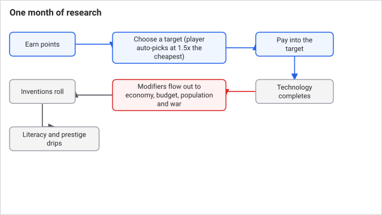
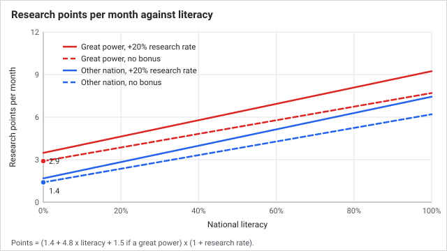
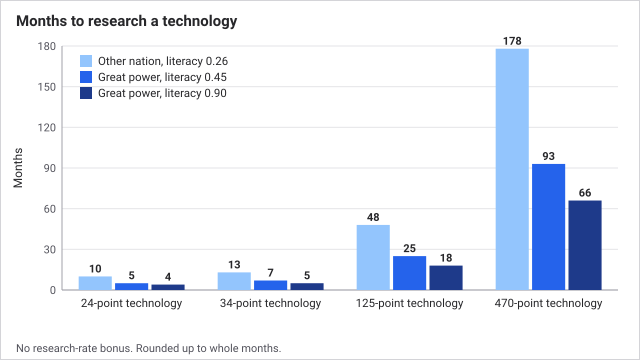
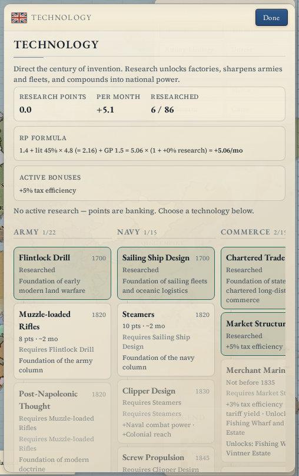
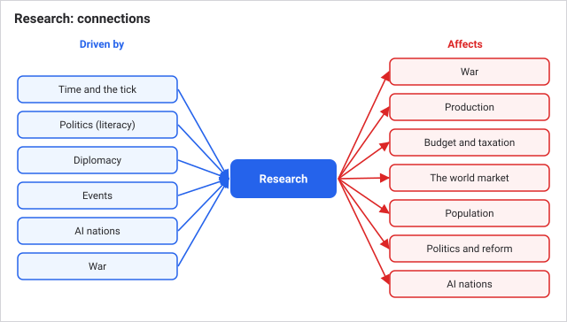

# Research

Research turns a literate population into lasting advantages. Each month your nation earns research points, spends them on one technology at a time, and gets that technology's bonuses for the rest of the game. It decides what you can build, how fast you march and how much your taxes yield, so a lead in research compounds for decades.

## How it works

Every month, in this order (see [Time and the tick](time-and-the-tick.md)):

1. **Earn points.** Your points per month are a flat base plus a literacy bonus, plus a bonus if you are a great power, all scaled by any research-rate bonuses you have.
2. **Choose a target.** An AI nation with no target picks one at once. You pick your own. If you leave yours empty, the game starts the cheapest available technology for you once your banked points reach 1.5 times its cost.
3. **Pay.** All banked points move into the target, up to its cost. When it is paid, the technology completes. Left-over points stay in the bank for the next one.
4. **Inventions.** Each invention whose technology you hold rolls a chance to appear.
5. **Drips.** Technologies that raise literacy or prestige add a little every month.

**Literacy** is the share of your people who can read (0 to 1). It is the main engine. It grows from the school reform and from clergy, see [Politics and reform](politics-and-reform.md), and from culture technologies.

There are 86 technologies in five columns: Army (22), Navy (15), Commerce (15), Industry (18) and Culture (16). Each has a cost from 5 to 480 and a year before which it cannot be researched, so you cannot rush late technology in an early era. Most also need an earlier technology.

### Key numbers

| Thing | Value |
|---|---|
| Flat base | 1.4 points a month |
| Literacy bonus | 4.8 x literacy |
| Great power bonus | +1.5 points a month |
| Research-rate bonus | multiplies the total, from culture and commerce technologies |
| Bank cap | 10,000 points |
| Auto-pick (when idle) | bank of 1.5 x the cheapest available cost |
| Tech cost range | 5 to 480 |
| Invention chance | 4% to 6% a month, times (0.5 + literacy) |

### What a technology gives

Technologies carry **modifiers**: more factory or resource output, better tax collection, faster research and literacy growth, prestige, population growth, faster armies, longer supply reach, higher factory profit and tariff yield. Many also **unlock recipes**, so a factory you have not researched is a factory you cannot build. The Technology panel shows each tech's effects and what it unlocks.

### What the AI researches

AI nations pick at random, weighted by their situation and ruling party. A reactionary government pours points into its army. A liberal one builds commerce and industry. After a few decades this shows: a neighbour's technology profile tells you who has been governing it.

| Ideology | Favoured categories (extra weight) |
|---|---|
| Reactionary, Fascist | Army, Navy (+1.1), Culture (+0.3) |
| Liberal | Commerce, Industry (+0.9) |
| Socialist, Communist | Industry (+0.9), Army (+0.4) |
| Conservative | Commerce, Culture (+0.45) |

These are bonuses on a base weight of 1. They apply to the AI only. A nation at war adds +1.8 to Army and Navy, and one near the infamy limit adds a smaller military push.

## Worked example

You rule a great power with literacy 0.45 and no research-rate bonus. Points per month: 1.4 + 0.45 x 4.8 + 1.5 = 5.06. Professional Drill costs 24, so it takes 5 months (24 / 5.06 = 4.7). Field Logistics at 34 takes 7 months.

A small nation at literacy 0.26 earns 1.4 + 1.25 = 2.65 a month and needs 13 months for that same Field Logistics. A technology costing 125, such as Staff Corps, takes the great power 25 months. The panel shows each technology's estimate.

## What you can do

Open the **Technology** panel. It has one column per category and shows cost, estimated months and what is blocking each technology.

- **Pick a target.** Click any available technology. Switching is free: progress already sunk into the old target goes back to your bank as points.
- **Halt research.** The "Halt research" button banks everything. Use it if you want to save points for a specific technology.
- **Raise literacy.** The surest way to speed everything up. Invest in schools in the **Politics** panel.
- **Watch inventions.** The panel lists them with their current monthly chance. You cannot choose them, but you can raise literacy to make them likelier.

Tips:

- **Literacy is the research budget.** Everything else is a multiplier.
- **Research-rate technologies first, if you can afford the politics.** They raise the speed of everything that follows.
- **Check the unlock before you plan a factory.** If the recipe says locked, that is the missing technology.
- **Do not leave it idle.** Banked points are not lost, but an empty target wastes the months you could be earning bonuses.

Edge cases:

- **Zero literacy.** You still earn the 1.4 base, so progress never fully stops.
- **At the 10,000 cap.** New points are discarded. This takes a very long idle spell.
- **Nothing available.** If every technology of the era is done or gated by year, points bank until the calendar opens more.
- **Technology granted by other means.** If an event or a union gives you the technology you were researching, the target clears and you choose again.

## Connections

**Driven by:**

- [Time and the tick](time-and-the-tick.md): research runs once a month, after politics.
- [Politics and reform](politics-and-reform.md): the school reform and clergy raise literacy, the main input. The ruling party sets what the AI researches.
- [Diplomacy](diplomacy.md): great powers earn +1.5 points a month, and high infamy pushes AI research toward the military.
- [Events and decisions](events-and-decisions.md): events can grant points or literacy.
- [AI nations](ai-nations.md): AI target choice is weighted by war posture and ruling ideology.
- [War](war.md): nations at war weight army and navy technology more heavily.

**Affects:**
- [Events and decisions](events-and-decisions.md): research state feeds event triggers.

- [War](war.md): technologies unlock regiment and ship types and shorten marches.
- [Production and industry](production-and-industry.md): technologies unlock factory recipes and add factory and resource output.
- [Budget and taxation](budget-and-taxation.md): tax efficiency and tariff yield come from technology.
- [The world market](the-world-market.md): trade efficiency raises what tariffs return.
- [Population](population.md): some technologies speed population growth.
- [Politics and reform](politics-and-reform.md): culture technologies add monthly literacy and prestige.
- [AI nations](ai-nations.md): the ideology table gives AI nations their character.

## Status

Live in every scenario and era, with no difficulty setting. A nation starts with every technology dated up to its scenario's starting technology year, so a later era starts with a much deeper tree. Research works the same for AI nations and human players, except for the target-picking rules above.

Last checked: 2026-10-29, version 1.7.0

## Exact rules

Source `src/sim/systems/research.ts` unless noted; technology data in `src/data/techs.ts`. It runs in the monthly block of `src/sim/world.ts` after politics and before diplomacy.

**Points per month** = (`RESEARCH_FLAT_BASE` 1.4 + `RESEARCH_LITERACY_WEIGHT` 4.8 x clamp(literacy, 0, 1) + `RESEARCH_GP_BONUS` 1.5 if great power) x (1 + max(0, research rate)). The bank (`researchPoints`) is clamped to `RESEARCH_POINT_CAP` 10,000.

**Target choice.** A target that is already researched is dropped. With no target, an AI nation picks by weight. The player is auto-assigned the cheapest available technology only once the bank is at least `AUTO_PICK_BANK_RATIO` 1.5 times its cost. An AI nation picks from available technologies with weight 1 plus: at war, +1.8 for Army and Navy; else if infamy is over 0.65 x 18, +1.2 for Army and Navy and +0.45 for Industry; else +1.35 for Industry and Commerce. Great powers add +0.4 for Culture. Then the ideology bonus (table above). The roll is a single weighted draw.

**Payment.** need = cost - progress. transfer = min(bank, need). Progress completes the technology when it reaches cost. Switching or halting returns all progress to the bank, capped at 10,000 (`setNationResearch`).

**Availability** (`techAvailability`): not already known, prerequisite known, and current year at least the technology's year.

**Inventions.** 20 inventions in `src/data/techs.ts`, monthly chance 0.04 to 0.06 each. An invention rolls once a month while its prerequisite technology is known and it is not owned. Chance = `monthlyChance` x (0.5 + clamp(literacy, 0, 1)). One random draw per eligible invention.

**Modifier drips.** Literacy gain = `literacyRate` x (1 - literacy) a month, with literacy capped at 0.98. Prestige gain = `prestigeMonthly` a month, capped at 10,000 total. Starting literacy is 0.12 for uncivilized nations, 0.45 for great powers and 0.26 for the rest (`src/sim/bootstrap.ts`); schools and clergy add `(0.0005 + school level x 0.0012 + clergy share x 0.05) x (1 - literacy)` a month (`src/sim/politics.ts`).

**Modifier types** and who reads them: factory throughput and factory profit (`src/sim/systems/economy.ts`), resource throughput (economy), tax efficiency and tariff yield (`src/sim/systems/budget.ts`, `src/sim/systems/market.ts`), research rate (this file), population growth (`src/sim/systems/pops.ts`), army movement and supply range (`src/sim/systems/war.ts`). Army movement is capped at a 35% cut in march time. Supply range is added to a base of 2 provinces, but the supply search in `war.ts` never looks beyond two provinces from friendly ground, so bonuses above 2 currently change nothing. Recipe unlocks use `requiresTech` in `src/data/gameData.ts`.

**Technology data.** Cost range 5 to 480. Examples: Field Logistics 34 (1838), Staff Corps 125 (1876), Integrated Logistics 470 (1945).
