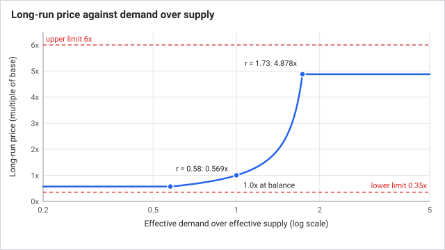
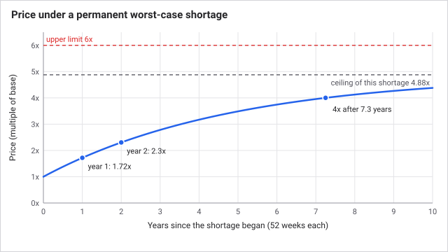
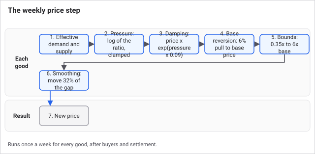
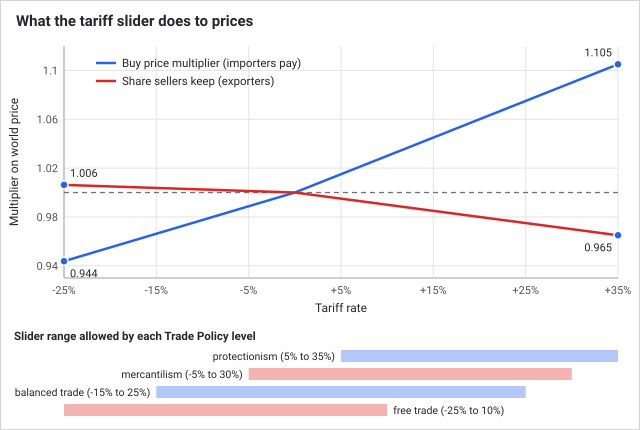
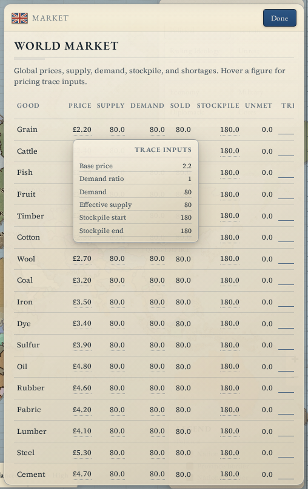
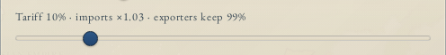

# The world market

Every good in Grand Century trades on one shared world market at one world price. There are no regional prices. What differs between nations is not the price of a good but what you pay and keep after your own tariff. Prices move once a week, after that week's buying and selling are finished, and they move slowly and within hard limits.

## How it works

Each good has a **base price**, the value the game pulls it back toward (grain 2.2, steel 5.3, wine 6.4 and so on). The weekly price move compares what buyers wanted with what was available:

1. **Effective demand** is units actually bought (including your standing buy orders), plus unsold output swept into the world stockpile that week, plus 32% of the demand that went unmet. Unmet demand counts, so a good people wanted but could not get still pushes the price up, but less than a completed sale.
2. **Effective supply** is what producers put on the market, plus 75% of the world stockpile carried into the week. Stored goods weigh on the price, but less than fresh output.
3. **Pressure** is the natural log of demand over supply, clamped to plus or minus 0.55 so one extreme week cannot spike a price.
4. Pressure is applied at 9% strength to the current price to get a target.
5. The target is pulled 6% of the way back toward the base price.
6. The result is held between 35% and 600% of base price.
7. The price moves only 32% of the way from where it is to that target.

The effect is slow and bounded. The biggest one-week move is about 1.5%. Doubling a price takes more than a year of the worst-case shortage, and a permanent shortage settles at about 4.9 times base, never the full 6. A permanent glut settles at about 0.57 times base.

Unsold goods are not destroyed. They go into the world stockpile and stay there, pressing prices down in the following weeks.

| Item | Value |
| --- | --- |
| Price changes per week | once, after trading |
| Single-week move, worst case | about +1.5% or -1.5% |
| Price floor and ceiling | 35% and 600% of base |
| Long-run price under maximum shortage | about 4.9 times base |
| Long-run price under maximum glut | about 0.57 times base |
| Tariff slider overall | -25% to +35% |
| Buy price at 10% tariff | x1.03 |
| Seller keeps at 10% tariff | 99% |
| Standing order limit | 40 units per good per day |

### Tariffs

Your tariff is one slider. It sits in the Budget panel and does two things at once.

- **On every purchase** your pops, factories and stockpile make, a positive tariff raises the price they pay by 30% of the tariff rate (a 10% tariff adds 3%) and the extra goes to your treasury as tariff income. A negative tariff (a subsidy) lowers the price and the treasury pays the difference.
- **On every sale** your producers make, a positive tariff cuts what the seller keeps by 10% of the tariff rate (a 10% tariff costs them 1%) and the cut goes to your treasury. A negative tariff lets sellers keep slightly more.

There is one world market, so the tariff applies to everything you buy, not only imports from abroad. It works like a sales tax on your own economy. Import effects are three times as strong as export effects, so protection is felt mainly by your own consumers.

Your Trade Policy reform ([Politics and reform](politics-and-reform.md)) limits where the slider can sit:

| Trade Policy | Tariff range |
| --- | --- |
| Protectionism | +5% to +35% |
| Mercantilism | -5% to +30% |
| Balanced Trade | -15% to +25% |
| Free Trade | -25% to +10% |

### The national stockpile

You can hold goods in a national reserve and set a standing buy or sell order for each good. Orders run once a week, after pops have shopped. Buy orders spend treasury on whatever pops left behind, at world price plus your tariff, and add to your reserve. Sell orders put goods from your reserve on the market, add supply, and pay the treasury the world price minus your export cut.

Your reserve does not feed pops or factories, and armies do not draw on it. It is a trading position: buy when a good is cheap, sell when it is dear, or sell to raise cash.

## A worked example

Grain has base price 2.2 and sells at 2.2. This week pops and factories ask for 1,500 units, producers supplied 1,000, so 1,000 sell and 500 go unmet. The stockpile is empty.

- Effective demand = 1,000 + 0.32 x 500 = 1,160. Effective supply = 1,000.
- Ratio = 1,161 / 1,001 = 1.16, pressure = ln(1.16) = 0.148.
- Target = 2.2 x e^(0.148 x 0.09) = 2.230. Pulled 6% back toward 2.2 it is 2.228.
- New price = 2.2 + 0.32 x (2.228 - 2.2) = 2.209. Even with a third of demand going unmet, grain rises by only 0.4% in a week.

If that shortfall lasted every week, the price would creep up and level off. A permanent effective demand to supply ratio of 1.5 settles near 2.39 times base, which is 5.27 for grain. A pop buying grain at 10% tariff pays 2.2 x 1.03 = 2.27 per unit.

## What you can do

- **Read the market.** Open the **Market** panel (Economy group in the side rail). Each good shows price, supply, demand, sold, stockpile, unmet demand, a price trend line, your reserve and your standing order. Hover a price for the pricing trace: base price, demand ratio, effective supply and stockpile. A price is flagged when demand is more than 5% above supply or unmet demand exceeds 5% of supply. A rising price on a good you depend on is an early warning.
- **Set the tariff** with the Tariff slider in the **Budget** panel. The label beside it shows the buy multiplier and what exporters keep.
- **Place standing orders.** In the Market panel's last column press **Buy** or **Sell** for a good (each sets 15 units a day) and **Off** to cancel. The rules allow up to 40 units a day per good; the panel buttons use 15.
- **Change the slider range** by enacting a different Trade Policy.

Tips:

- You cannot corner a market by producing more. Extra supply pulls the price down toward base, and unsold output does not pay you ([Production and industry](production-and-industry.md)).
- Prices revert. Any advantage from a price shock is temporary, so plan around structural supply.
- A tariff is mostly a tax on your own pops and factories. If your people are hungry, lowering it makes food cheaper; if the treasury is empty, raising it is quick money but cuts what pops can buy.
- Buy orders are limited by your treasury and never push it below zero.

## Connections

**Driven by:**

- [Time and the tick](time-and-the-tick.md): trading and the price move are weekly.
- [Production and industry](production-and-industry.md): output is supply, and factory inputs are demand.
- [Population](population.md): pops are the consumers whose shopping makes up most demand.
- [Politics and reform](politics-and-reform.md): Trade Policy sets the range of the tariff slider.
- [Research](research.md): trade efficiency technologies strengthen positive tariffs.
- [Events and decisions](events-and-decisions.md): some events change a good's price or the world stockpile directly.

**Affects:**

- [Population](population.md): prices and tariffs decide how far a pop's money goes, so they decide needs met.
- [Production and industry](production-and-industry.md): prices set what output earns and what inputs cost, and sell rates decide how much producers are paid.
- [Budget and taxation](budget-and-taxation.md): tariff income and import subsidies go straight into the monthly budget.
- [AI nations](ai-nations.md): AI nations set their tariff and weigh prices when choosing what to build.

## Status

Live in every scenario, with the same constants and the same 30 goods. Scenarios differ only in the starting position. Trade efficiency technologies change how strong a positive tariff is for the nation that has them. No difficulty setting changes the market.

Last checked: 2026-10-29, version 1.7.0

## Exact rules

**Weekly price move** (`runMarketWeekly`, `src/sim/systems/market.ts`; constants in `src/sim/balance.ts`). Runs last in the weekly pass, after production, pops, standing orders and settlement.

- `unmet` = max(0, requested demand - bought by consumers).
- `effectiveDemand` = consumer purchases + stockpile absorption + `unmet` x 0.32 (`marketUnmetDemandWeight`). Stockpile absorption is producer supply nobody bought, which rolls into the world stockpile.
- `effectiveSupply` = producer supply + start-of-week world stockpile x 0.75 (`marketStockpileWeight`). Producer supply includes your sell orders.
- `ratio` = (effectiveDemand + 1) / (effectiveSupply + 1).
- `pressure` = clamp(ln ratio, -0.55, 0.55) (`marketPressureClamp`).
- `pressureTarget` = price x e^(pressure x 0.09) (`marketDamping`), limited to 0.08 to 500 (`minPrice`, `maxPrice`).
- `anchored` = pressureTarget + (base - pressureTarget) x 0.06 (`marketBaseReversion`).
- Bounded to base x 0.35 (`deflationGuard`) up to base x 6 (`inflationGuard`), and never outside 0.08 to 500.
- `next` = price + (bounded - price) x 0.32 (`marketSmoothing`), bounded again the same way.
- Long-run price under a constant ratio r: P = 0.06 x base / (1 - 0.94 x e^(0.09 x clamp(ln r))). With the pressure clamp this gives 4.88 times base at r above 1.73 and 0.569 times base at r below 0.58.
- Price trend keeps the last 8 prices. Supply, demand, sold, unmet and world stockpile are recorded per good, and a conservation check (supply plus stockpile equals purchases plus remaining stockpile) is stored.
- The world stockpile starts at 180 units per good (`src/sim/bootstrap.ts`). It has no decay or cap.
- Events can multiply a price by 0.4 to 2.5 within 0.3 to 3.5 times base, and add to the world stockpile up to 50,000 (`src/sim/systems/events.ts`). The next weekly move pulls a price back inside the 0.35 to 6 limits.
- Daily `runMarketDaily` only clamps and cleans values; it does no trading.

**Buying** (`buyFromMarket`, `buyFromMarketQuick`): the unit price paid is the world price x (1 + tariff margin). A buyer takes from this week's producer supply first, then from the world stockpile. Amount bought = min(desired, available supply, budget / unit price). Factories buy with no budget limit.

**Tariffs** (`importMultiplier`, `exportMultiplier`):

- Import multiplier = 1 + rate x 0.3 (`importTariffPriceImpact`) when rate is 0 or more. For a negative rate it is max(0.72, 1 + rate x 0.3 x 0.75). Rate is clamped to -1 to 1 first, so the 0.72 floor is never reached (the lowest value is 0.775 at -100%; at the slider's -25% it is 0.944).
- Export keep rate = max(0.82, 1 - rate x 0.1) (`exportTariffPriceImpact`) when rate is 0 or more; 1 + |rate| x 0.1 x 0.25 when negative. The 0.82 floor is never reached (the lowest is 0.90 at +100%; at the slider's +35% it is 0.965).
- Technology `tradeEfficiency` t multiplies a positive import margin by (1 + t) and the export cut by (1 + t).
- Tariff flow = amount x world price x margin, booked to the buyer's nation as `monthlyTariffIncome` (negative for subsidies), settled in the monthly budget. Export cuts are booked the same way on sold units.
- The tariff slider range is set by Trade Policy level 0 to 3 (`tariffBandForTradePolicy`, `src/sim/balance.ts`): protectionism 0.05 to 0.35, mercantilism -0.05 to 0.30, balanced trade -0.15 to 0.25, free trade -0.25 to 0.10. A nation's default tariff is 0.10 (`src/sim/bootstrap.ts`). Multipliers are cached once per day, so a slider change applies from the next day.

**Standing orders** (`runStockpileOrders`): daily amount clamped to 0 to 40 (`stockpileOrderMaxDaily`); weekly amount = 7 x daily amount. Buy: purchase with budget max(0, treasury), treasury reduced by the spend (floor 0), reserve increased by units bought. Sell: units = min(weekly amount, reserve), added as supply, treasury increased by the sale revenue after the export cut, reserve reduced. Runs after pops and before settlement.

**Base prices** (`GOODS`, `src/data/gameData.ts`): grain 2.2, cattle 2.4, fish 2.3, fruit 2.1, timber 2.6, cotton 2.8, wool 2.7, coal 3.2, iron 3.5, dye 3.4, sulfur 3.9, oil 4.8, rubber 4.6, fabric 4.2, lumber 4.1, steel 5.3, cement 4.7, glass 4.5, paper 4.4, fertilizer 4.8, furniture 6.2, clothes 6.0, liquor 5.8, wine 6.4, small arms 8.4, artillery 9.2, canned food 7.8, machine parts 9.5, ammunition 7.2, steamers 8.9.

**UI** (`src/ui/panels/MarketPanel.tsx`): a price is flagged when demand > 1.05 x supply or unmet > 5% of supply; Buy and Sell buttons set 15 units per day.
